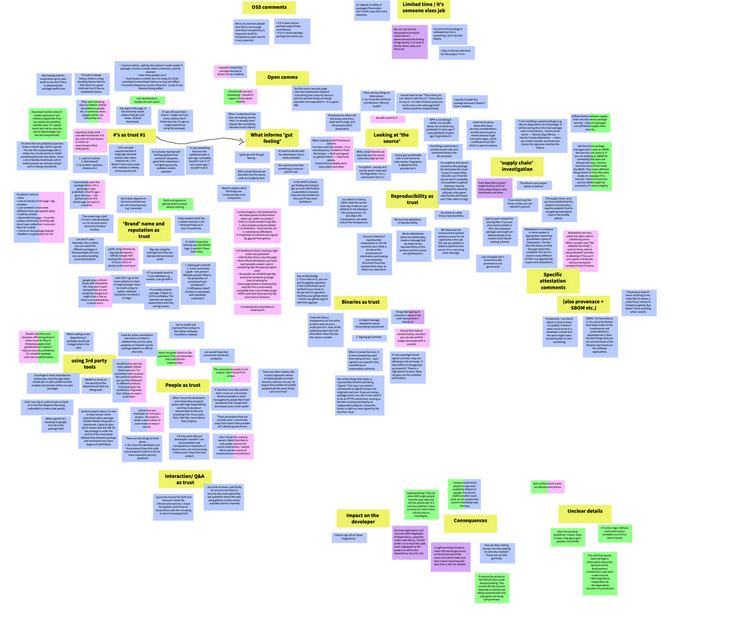


# 証明（アテステーション）の UI/UX スタイルガイド {#style-guide-for-attestations-uiux}

著者: [Eriol Fox](https://github.com/Erioldoesdesign)、[Nicole Harris](https://github.com/nlhkabu)、[Dustin Ingram](https://github.com/di)、[Phillip Drummond](https://github.com/oilsinwater)、[Superbloom Design](https://github.com/sprblm)

最終更新: 2026 年 10 月

## 背景 {#background}

このガイドでは、私たちが行ったユーザー調査の結果を、要約・補足・根拠とともに示します。そのうえで、PyPI、RubyGems.org、npm という 3 つのソフトウェアパッケージレジストリが最初に取り入れるときの手引きとなるよう、「最初の一歩として良い」UI の例と推奨事項を示します。この 3 つのレジストリを取り上げるのは、いずれも最も広く使われ、活発に進化を続けているオープンソースのパッケージエコシステムだからです。それぞれが異なる方針を持ち、幅広い種類のユーザーとプロジェクトを支えています。ソフトウェアサプライチェーン全体の中でも目立つ存在なので、証明（アテステーション）の UX とドキュメントを考えるうえで代表的なモデルになります。

このプロジェクトは、証明のユーザー体験（UX）を改善するために、OpenSSF Securing Software Repositories ワーキンググループが始めたものです。詳しい経緯は、最初の依頼とプロジェクトのタスクボードで確認できます。

* 最初の依頼: [https://github.com/ossf/tac/issues/424](https://github.com/ossf/tac/issues/424)
* プロジェクトのタスクボード: [https://github.com/orgs/ossf/projects/36](https://github.com/orgs/ossf/projects/36)

すぐ実行に移せる細かさで扱ったのは 3 つのレジストリだけですが、ここに示す手引きとテンプレートは、ほかにも応用できるように作ってあります。ほかのエコシステムのメンテナーやコントリビューターのみなさんにも、安全で一貫したリポジトリ運用を育てるためのこれらの原則を、ご自身のレジストリに当てはめ、発展させていただきたいと考えています。実際、これらの推奨事項は、パッケージレジストリのページレイアウト以外でも使える柔軟さを意図しており、今後も繰り返し見直して改善していくべきものです。この取り組みを発展させる方法については、このガイドのコントリビューションのページをご覧ください。

## 作業計画とチーム {#work-plan--team}

公開している作業計画は[こちら](https://github.com/orgs/ossf/projects/36?pane=issue&itemId=115907793&issue=ossf%7Cwg-securing-software-repos%7C72)で見られます。このプロジェクトに関わった個人と組織は次のとおりです。

- [Open SSF](https://openssf.org/)
- [OpenSSF Securing Software Repositories ワーキンググループ](https://repos.openssf.org/)
- [Kabu Creative](https://kabucreative.com/)
- [Superbloom Design](https://superbloom.design/)
- OSS コミュニティから参加した 15 名以上のユーザーテスト協力者

## スタイルガイド {#the-style-guide}

スタイルガイドは 7 つの部分に分かれています。

* はじめに、背景、コントリビューションの案内（このページ）
* [最低限の UI 要件（レベル A）](attestations-style-guide/level-a.html)
* [中程度の UI 要件（レベル AA）](attestations-style-guide/level-aa.html)
* [最高水準の UI 要件（レベル AAA）](attestations-style-guide/level-aaa.html)
* [UI の詳細](attestations-style-guide/ui-details.html)
  * Attestations、Build、Source、Integrity の UI の詳細
  * 信頼を補強するそのほかの手がかり
  * アイコン
  * ハイパーリンクと情報へのリンク
  * ドキュメント
  * 言語のローカライズ
* [ドキュメントに関する推奨事項](attestations-style-guide/documentation.html)
* [PyPI での実装のケーススタディ](attestations-style-guide/pypi-case-study.html)

## 調査 {#research}

私たちはユーザーを対象とした調査を 3 つの段階に分けて行いました。加えて、プロジェクトの期間を通じて二次調査（デスクリサーチ）も行いました。

* **第 1 段階** 第 1 段階は探索的な調査で、ユーザーがパッケージのセキュリティ情報をどのように見つけるか、そして証明に対して最初にどのような印象を持つかに焦点を当てました。手法は、ユーザーインタビュー、行動観察、そして実際に公開されている既存のコンテンツへのフィードバックに基づいています。

* **第 2・第 3 段階** 第 2 段階と第 3 段階では、証明の最初の UI デザインに対するユーザビリティテストを行いました。あわせて、提案したドキュメントの利用しやすさと分かりやすさについてもフィードバックを集めました。

調査の資料は[こちら](https://github.com/orgs/ossf/projects/36/views/3)で公開しています（二次調査については[こちら](https://www.nngroup.com/articles/secondary-research-in-ux)）。

## 方法論 {#methodology}

探索的な調査では、文脈的調査（contextual inquiry）と半構造化インタビューの手法に従いました。

* <https://www.nngroup.com/articles/user-interviews/>
* <https://www.nngroup.com/articles/contextual-inquiry/>

探索的な調査で得た結果をまとめるために、テーマ分析（Thematic analysis）と親和図法（Affinity Diagramming）を使いました。

* <https://www.nngroup.com/articles/affinity-diagram/>

最後に、提案したデザインとドキュメントを評価するために、ユーザビリティテストと選好分析を使いました。

* <https://www.nngroup.com/articles/usability-testing-101/>
* <https://www.youtube.com/watch?v=-XYTk5MVvK0>

## 証明のペルソナ {#attestations-personas}

調査の指針とするために、パッケージリポジトリ上で証明に触れる可能性のあるユーザーの類型を表す、3 つのペルソナを作りました。それぞれのペルソナには、ユーザーの役割、目標、不満、そしてプロジェクトに望む成果についての情報が含まれています。

1. セキュリティアーキテクト（The Security Architect）（関心がある / 知識がある）
証明について十分な知識を持ち、ソフトウェアセキュリティの基礎を深く理解しているセキュリティの専門家を表します。このユーザーの第一の目標は、役割の重要な一部として、ソフトウェアサプライチェーンを安全にすることです。

2. 実務的な開発者（The Pragmatic Developer）（ある程度関心があり、ある程度知識がある）
証明のことは知っているものの、セキュリティと、競合する多くの優先事項との釣り合いを取らなければならないユーザーを表します。エンジニアリングチームのリーダー、シニアソフトウェアエンジニア、あるいは製品の構築と出荷を担う DevOps エンジニアなどが当てはまります。

3. たまたま使う利用者（The Incidental Consumer）（関心がなく、知識もない）
証明のことを知らないユーザーを表します。このユーザーにとって、コードは道具であって職業ではないからです。Python を使うデータアナリスト、JavaScript の静的サイトジェネレーターを使うデザイナー、趣味で使う人、チュートリアルに沿って学ぶ学生などが当てはまります。

ペルソナの全文は[こちら](https://github.com/ossf/wg-securing-software-repos/issues/70)で見られます。ペルソナについて詳しくは[こちら](https://www.nngroup.com/articles/personas-study-guide/])。

## 調査結果 {#research-results}

ユーザー調査の、編集していない生のメモは次の場所にあります。

* [https://github.com/ossf/wg-securing-software-repos/issues/66](https://github.com/ossf/wg-securing-software-repos/issues/66)
* [https://github.com/ossf/wg-securing-software-repos/issues/83](https://github.com/ossf/wg-securing-software-repos/issues/83)

この調査から得た知見が、このガイドの推奨事項の土台になっています。たとえば次のような点についての発見です。

1. ユーザーインターフェースの好み
2. ユーザーがパッケージの安全性をどのように評価するか
3. 技術的な用語や概念の理解度
4. ユーザーがどこで、なぜ情報を探すのか
5. 証明に対する意見、証明が信頼に与える影響、そして証明の近くにあるどのような情報が証明への信頼を助けるか

## スタイルガイドの使い方 {#how-to-use-the-style-guide}

このスタイルガイドの以降のページでは、証明に関するユーザーインターフェース（UI）要素の表示について推奨事項を示します。あわせて、インストールするパッケージの安全性・セキュリティ・完全性への信頼を築くうえでユーザーが役に立つと感じた、そのほかの要素も取り上げて紹介します。

すべての推奨事項は、ユーザー調査とテストに基づいています。調査とテストは、スタイルガイドの冒頭で説明した各ペルソナに当てはまるユーザーを対象に行いました。

パッケージレジストリごとに、構造やデザインの面で固有の事情があることは理解しています。そのため、これらのガイドラインをどこまで実装するかは、各レジストリの判断に委ねられます。私たちは、さまざまなセクションの大きさや、パッケージの見せ方の違いに対応できるように、UI の推奨事項を段階的に用意しました。たとえば、長い README をパッケージページにそのまま埋め込み、ほかの内容を下に押しやっているレジストリがあります。メインのセクションが広く、サイドバーが小さいレジストリもあります。複数のページやメニューのための仕組みを備え、新しいページやセクションを組み込みやすいレジストリもあります。

既存のビジュアルデザインシステムの一貫性を保ちながら、ご自身のパッケージレジストリやプラットフォームに最も合う実装から始めることをお勧めします。色、ハイパーリンクのスタイル、枠線の属性（太さ、色、角の丸み）といった、ブランドの中核となる要素は変えないことをお勧めします。私たちが推奨する UI 要素は柔軟に使えるように設計してあり、ビジュアル言語を根本から変えなくても、ほとんどの既存システムに組み込めるはずです。新しい改訂案を、その根拠とともに提供していただく機会はいつでもあります。

オープンソースの精神にのっとり、実際的に可能な範囲で、プロジェクトの資料はすべて公開しています。調査の手順書やペルソナから、匿名化したユーザーテストのメモ、Penpot の UI デザインまでが含まれます。詳しくは、コントリビューションのページをご覧ください。

## スタイルガイド: この取り組みへのコントリビューションと改訂 {#style-guide-contributing-or-iterating-on-this-work}

これは、証明の UI と、それを支える関連情報についての推奨事項の最初の版です。開発者ペルソナのあらゆる理解度を対象にしています。

この取り組みへの継続的なコントリビューションを歓迎します。たとえば次のようなものです。

1. これまでのユーザー調査で定めたガイドラインを発展させる、あるいはそれに沿って行う、継続的なユーザー調査: [https://github.com/ossf/wg-securing-software-repos/issues/82](https://github.com/ossf/wg-securing-software-repos/issues/82) と [https://github.com/ossf/wg-securing-software-repos/issues/66](https://github.com/ossf/wg-securing-software-repos/issues/82)

2. 別案となる、より洗練された適切な UI の改訂版の開発。パッケージの安全性とセキュリティに対するユーザーの信頼を支えるという観点で、分かりやすさと有用性をユーザーとともにテストしたもの: [https://github.com/ossf/wg-securing-software-repos/issues/65](https://github.com/ossf/wg-securing-software-repos/issues/82)

3. ドキュメントのテンプレートと例の改善と改訂: [https://repos.openssf.org/](https://github.com/ossf/wg-securing-software-repos/issues/82)

4. 独自アイコンのグラフィックデザインの向上と、証明専用のロゴやシンボルの開発（このスタイルガイドのアイコンのページを参照）。

5. そのほかのコントリビューションや提案は、OpenSSF の Securing Software Repositories ワーキンググループにお寄せください [https://github.com/ossf/wg-securing-software-repos](https://github.com/ossf/wg-securing-software-repos/issues/82)

---

次: [最低限の UI 要件（レベル A）](attestations-style-guide/level-a.html)

