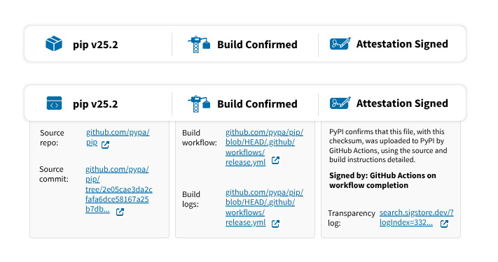
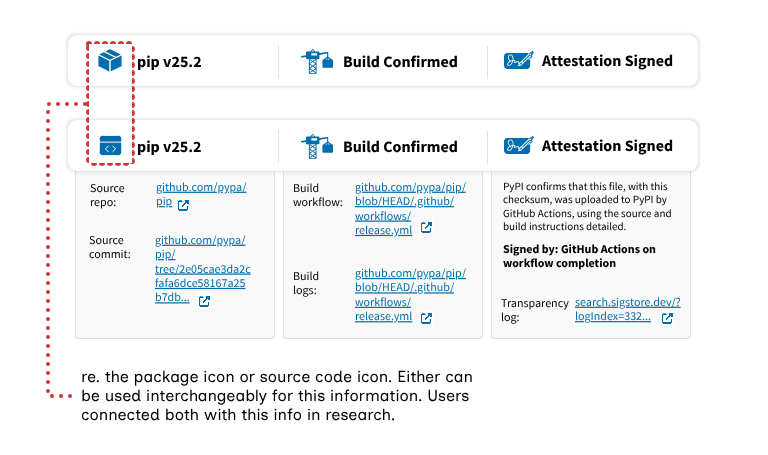
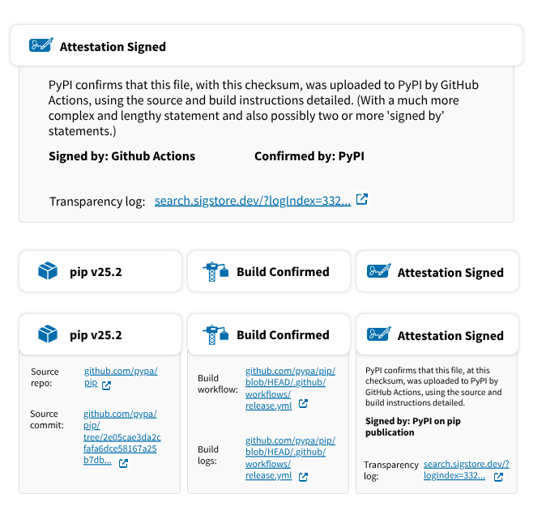
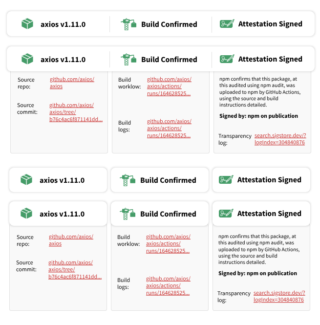
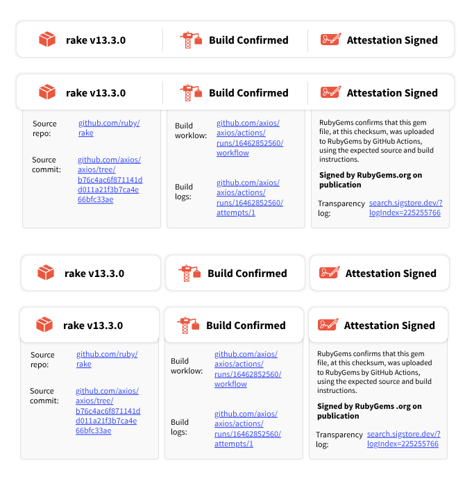
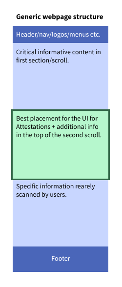


# スタイルガイド: レベル A - 最低限の要件 {#style-guide-level-a---lowest-requirements}

スタイルガイドのこのセクションでは、パッケージレジストリで証明（アテステーション）の情報を表示するための、最低限（レベル A）の要件を定めます。

1. 証明の情報は、レジストリのページ上で、目に入るけれども主張しすぎない位置に置くべきです
2. 幅広い種類のユーザー（冒頭の紹介で説明したとおり）が証明を理解できるだけの情報を含むべきです
3. ユーザーが本来の目的、たとえば「このパッケージが目的に最も合った選択肢かどうかを知ること」を達成する妨げになってはなりません

このレベル A の要件は、最小限で、折りたたみができ、互いに区別された UI の「パネル」一式を説明するものです。パネルには、その中で展開できる情報にふさわしいアイコンと見出しが付きます。

以降の UI の例、バリエーション、推奨事項とあわせて、その判断に至ったユーザー調査上の根拠と知見を示し、説明します。

編集していないユーザー調査のセッション記録は、このプロジェクトに関連する公開の issue で見られます。

* ユーザーテストのセッション Issue #82: [https://github.com/ossf/wg-securing-software-repos/issues/82](https://github.com/ossf/wg-securing-software-repos/issues/82)
* ペルソナと調査 Issue #66: [https://github.com/ossf/wg-securing-software-repos/issues/66](https://github.com/ossf/wg-securing-software-repos/issues/66)

この取り組みにコントリビュートしたい、コメントしたい、改訂したいという場合は、デザインのコントリビューションに関するドキュメントをご覧ください。

---

_証明の情報を視覚化するための、最低限のレベル A の要件を示す UI の例のスクリーンショット_

これは、3 カラムのレイアウトを使うようなウェブページのメインセクションに置くことを想定しています。つまり、メインセクションが幅の 3 分の 2 を占め、サイドバーが 3 分の 1 を占めるレイアウトです。

このバージョンでは、アイコンと見出しの組が、縦棒（パイプ）で区切られています。縦棒の長さは、コンテナのボックス全体の高さのおよそ 75% です。

パネルには枠線やドロップシャドウの効果を付けてもかまいませんが、プラットフォームのデザインシステムやスタイルに合うように調整するべきです。

このパネルは、展開の操作なしでそのまま使うこともできますが、そうすることはお勧めしません。

このコンポーネントはパネルなので、それぞれの見出しはクリックでき、その下に追加の情報が展開されるべきです。展開と折りたたみの動きは、一瞬で切り替わるのではなく、ユーザーにとって滑らかに変化するようにするべきです。

展開されたセクションには、枠線と背景色の両方が付いています。パネルの展開されたセクションが対応する見出しのすぐ近くにあるかぎり、どちらか一方を省いてもかまいません。

使える横幅に応じて、パネルと展開されたセクションの両方の幅を広げられます。読みやすさのために、プラットフォームごとに使える最小の文字サイズ（フォントサイズ）を必ず守ってください。

このレベル A のコンポーネントのスタイルでは、証明の文に使う語や文字を控えめにし、文の明確さと使えるスペースとの釣り合いを取ってください。必要であれば、複雑な文を収めるために、証明を下に全幅で配置できます（UI の例は次のページ）。

_アイコンの情報を詳しく示す UI の例のスクリーンショット_

_最低限の UI のうち、「ボックス」を分離したバージョンと、全幅の証明の「ボックス」がどう見えるかを詳しく示す UI の例のスクリーンショット_

**"Signed by" のメッセージ:**
"Signed by" のメッセージは、重要であることを示すために太字にするべきです。2 行にまたがってもかまいませんが、3 行になることは避けるべきです。

**リンクのスタイルとアイコン:**
この例では、前のページと同じく PyPI のビジュアルスタイルを使っており、青いハイパーリンクと、各リンクの横の外部リンクアイコンがあります。アイコンの色もフォントも、既存のスタイルに合わせて変えられます。「新しいタブで開く」アイコンを使うかどうかは任意です。

ここで左に示したコンポーネントのバリエーションは、パネルをまとめずに、別々のパネルとして 1 列に並べた場合のものです。展開できるセクションは、この場合も動作します。プラットフォームによっては、ページ全体のスタイルに合わせるため、あるいは操作できるボタンらしく見せるために、このように分離したパネルを好むかもしれません。

_最低限の UI のうち、タブや詳細を展開したバージョンを npm のスタイルで詳しく示す UI の例のスクリーンショット_

この例では、npm のビジュアルスタイルを使っています。

**リンクのラベル**
ここに表示しているリンクは、すべてユーザーとともに慎重にテストしたものです。調査の結果、ユーザーは証明の文の近くに次の情報が表示されることを期待していると分かりました。

1. ソースリポジトリとソースコミット
2. ビルドコミットとビルドログ
3. 透明性ログ（証明の文のセクションの中に）

リンクのラベルは左揃えにし、必要な場合は 2 行にまたがれるようにすることをお勧めします。

**ユーザーの安心感を高める**
パッケージのセキュリティについてユーザーが安心できるようにするための追加の推奨事項は、中程度（レベル AA）と最高水準（レベル AAA）の UI の推奨事項で詳しく説明しています。

ユーザーは、レジストリのページによくある「社会的証明（social proof）」（ダウンロード数、メンテナー、見覚えのあるプロジェクト名）も頼りにします。ハッシュやチェックサムも安心感を高めますが、それはユーザーがそれらを見分けられ、役割を理解している場合に限られます。

_最低限の UI のうち、タブや詳細を展開したバージョンを RubyGems のスタイルで詳しく示す UI の例のスクリーンショット_

この例では、RubyGems のビジュアルスタイルを使っています。

**ペルソナごとの、この UI の理解のしかた**
「セキュリティアーキテクト（Security architect）」のペルソナは、パッケージのセキュリティに安心するためにどの情報が必要かをすでに知っています。このペルソナにとっては、単純な視覚的・文字的な目印（たとえば、折りたたんだ状態のこの UI）でたいてい十分です。展開してさらに情報を見ることは、すでに持っている知識の確認になります。

「実務的な開発者（Pragmatic Developers）」と「たまたま使うユーザー（Incidental User）」のペルソナにとっては、単純な視覚的・文字的な目印（たとえば、折りたたんだ状態のこの UI）は役に立たず、情報の意味を推測させることになりかねません（その推測は当たることも外れることもあります）。

こうしたユーザーが証明の伝える内容を理解するには、この UI を展開した状態で見る必要があります。詳しい情報を見ると、たいていはさらに調べようという気になり、パッケージのセキュリティについての理解を組み立てていきます。ドキュメントへの追加のリンクを用意することも、こうしたユーザーが学ぶ助けになります。

_最低限のレベル A の UI を、ウェブページ上のどこに置くのが理想的かを示すスクリーンショット_

これらの最小限の要素をページのどこに置くかも、きわめて重要です。このスタイルガイドの次のページでは、例として取り上げた各パッケージレジストリでの最適な配置を図示しています（次のページは大きいので、該当する UI の例を見つけるにはスクロールが必要かもしれません）。

理想を言えば、この UI はページの最下部に置くべきではありません。長い README ファイルがほかの重要な情報を下に押しやるプラットフォームでは、なおさらです。ユーザーのフィードバックからは、セキュリティや証明の詳細に出会う前に、パッケージの中核となる機能を理解したいという強い希望が読み取れます。

これらの UI 要素をページの最上部やヘッダーのコンポーネントの中に置くと、次のようなジレンマが生じます。

1. 優先づけ: セキュリティをただちに考慮することを、事実上（ユーザーの言葉を借りれば）「強制」します。
2. 中断: パッケージの目的を手早く見きわめるという、ユーザーの本来の目的を妨げます。

セキュリティへの意識を高めることは重要ですが、それがパッケージの欠かせない情報を覆い隠すべきではありません。したがって、これらの要素を最初のスクロール範囲（ファーストビュー）に置けばセキュリティを優先できますが、一般には、2 番目のスクロール範囲の最上部に置くほうが効果的です。そのほうが、ユーザーの期待や、情報を見つけていく自然な流れによく合います。

次の、注釈付きのウェブページ全体の UI の例を、お好みの画像ビューアで開いてください。この画像は 5.7MB、キャンバスが 11300x12722 ピクセルと大きなものです。.pdf ファイルもあります。

* [ui-development-lowest-ui-version-a-level.png](images/ui-development-lowest-ui-version-a-level.png)
* [ui-development-lowest-ui-version-a-level.pdf](https://repos.openssf.org/attestations-style-guide/images/ui-development-lowest-ui-version-a-level.pdf)

注釈付きの画像ファイルには、次の文章が含まれています。

* パッケージについての重要な情報は、ページの最上部に残してあります。あわせて、すべてのユーザーが優先する情報、つまりダウンロード数と利用状況の指標も残しています。これらは、パッケージを信頼するうえでの第一の指標です。「多くの目」がそのパッケージを見て、使ってきたということだからです。ほとんどの開発者にとっては、これだけでパッケージを使う十分な理由になります。
* あまり人気がない、あるいは実績の少ないパッケージでは、ユーザーはこの種の「大きな数字」の情報に頼れません。そのような場合、ユーザーは信頼できる出どころからの権威ある情報を探します。たとえば、レジストリのウェブサイト、ソフトウェア財団のような権威ある団体、評判の良い名前を持つメンテナーなどです。
* ユーザーの中には、上に挙げた情報に頼るだけでなく、セキュリティの詳細を自分で確かめる人もいます。ハッシュや鍵が一致するかを調べ、ソースコードをレビューし、ビルドの過程や出どころの経路を調査するのです。こうしたユーザーはたいてい、ユーザーデータ（金銭に関する情報やそのほかの個人情報など）を漏らしかねない脆弱性を持ち込んだり、会社や大学のインフラのようなシステムを危険にさらしたりするリスクを避けようとしています。
* 私たちの調査では、256 チェックサムやそれに類する情報が何のためのものか、どう使うのかを理解していたのは、一部のユーザーだけでした。そのため、より複雑な、あるいはあまり知られていないセキュリティの用語や手順に関連づけて証明の UI 要素を配置すると、ユーザーがこうした難しい概念を理解する助けになります。UI をチェックサムより上に置くことで、ユーザーが見覚えのない用語や調べる時間のない用語に出会ったときに「離脱」してページに注意を払わなくなる、ということが起こりにくくなります。
* npm のこの例では、メンテナーが力を入れて作った多くの README の情報が、パッケージのページに表示されていることが分かります。テストでは、ユーザーはこれを妥当だとは感じたものの、いくぶん作り込みすぎだとも感じていました。必要な基本情報を見つけにくく、パッケージを使うかどうかを決めるのに必要な重要事項については、サイドバーに大きく頼っていました。
* これらの結果から、このようなパッケージページでは、証明の情報をサイドバーに示すのが最善だと私たちは考えます。サイドバーの選択肢については、スタイルガイドの後のほうで詳しく取り上げます。
* 可能であれば、README にあるメンテナー提供の情報と、キーワードや来歴（プロベナンス）の情報のようなインデックス側が管理する内容とを、ユーザーが見分けられる手段があるべきです。
* ユーザーが自分の見ている情報の種類を理解できるように、ここに区切り線や見出しなどの視覚的な区切りを加えることをお勧めします。
* 証明の情報を追加できる最初の場所は、ライセンス情報の上です。ライセンスはサイドバーにも詳しく載っているので、この種のページでは、証明の内容ができるだけ上に置かれていても、ユーザーはおおむね抵抗を感じません。ただし、ここでユーザーが証明の情報に気づく可能性は低いことに注意してください。ほとんどのユーザーは、ページのほかの場所や別のタブでは見つからないセキュリティ、来歴、証明の詳細をわざわざ探しているのでないかぎり、こうした長い README のページを最後までスクロールしません。それよりも、ビルドログ、コミットされたファイル、ソースコードなどの情報を探しにプロジェクトのリポジトリへ行くほうが普通です。
* このページ（やほかのページ）では、証明の文を支えるものとして私たちが提案する場所に、詳しい情報が重複して載っていることに気づくかもしれません。ユーザー調査と UI のテストから、ユーザーはこれを分かりにくいとも不快だとも感じないことが分かりました。ユーザーは「重複した」情報をむしろ心強く感じ、同じリンクに複数の場所で出会ったり、ドキュメントを複数のセクションで見かけたりすることを問題だとは考えませんでした。
* 調査担当者の仮説は、ユーザーは情報を区画に分けて探す、というものです。パッケージのビルドに関する証明やセキュリティ関連の情報をわざわざ探しているとき、ユーザーは、そう表示されていないほかの情報には、意識して注目先を切り替えないかぎり気づかない傾向があります。
* 同じ情報や似た情報が 2 つのセクションや場所に現れていることに気づいたとき、ユーザーは、見落とされかねない重要な情報を繰り返して載せるというパッケージページの丁寧さに、より安心感を持ちました。一致する 2 つのリンクが別々の場所に現れることでも、信頼は強まりました。この反応は、レジストリのパッケージ情報ページに対する全般的な不信と結びついていました。あるユーザーはこう述べています。「ここには好きなことを何でも書けるんでしょう？　それが正しくて正確だということを、いったい誰が承認して確かめているんですか？」同じリンクが 2 か所で繰り返されているのを見て、安心感を強めたユーザーもいました。ソースコミットが場所 1 と場所 2 の両方でリンクされ、それらが一致しているなら、誰かが一貫性を保っていることがうかがえるからです。
* したがって、このやり方を実装するプラットフォームは、情報の繰り返しを心配する必要はありません。ただし、異なる場所の間で、同じ見出し、用語、ラベル、リンク先を一貫して使うことがきわめて重要です
* 証明の情報を追加できる最初の場所は、ライセンス情報の上です。ライセンスはサイドバーにも詳しく載っているので、こうしたページでは、証明の内容ができるだけ上に置かれていても、ユーザーはおおむね抵抗を感じません。ただし、ここでユーザーが証明の情報に気づく可能性は低いことに注意してください。ほとんどのユーザーは、ページのほかの場所や別のタブでは見つからないセキュリティ、来歴、証明の情報をわざわざ探しているのでないかぎり、こうした長い README のページを最後までスクロールしません。それよりも、ビルドログ、コミットされたファイル、ソースコードなどの情報を探しにプロジェクトのリポジトリへ行くほうが普通です。
* メンテナー提供の内容（たとえばプロジェクトの説明）がどこで終わり、インデックス側が管理する内容（たとえばセキュリティ情報）がどこから始まるのかをユーザーが見分けられるように、視覚的な区切りや手段を設けることをお勧めします。この区切り線は、サイトの既存のスタイルに従っています。
* ここでは、分離した要素が、メインセクションの使える幅いっぱいに広がることも、展開できるセクションが追加の情報を表示するのに必要な最小限のスペースだけを占めることもできると分かります。
* また、この情報がプロジェクトの説明の下に置かれていることにも気づくでしょう。この配置には、ユーザーがこの情報を直前の見出し（この場合は Code of Conduct）に属するものと誤解するリスクがあります。このような場合は、区切り線と、"Security"、"Attestation"、"Provenance" などの関連する見出し（お好みのものでかまいません）を使うことをお勧めします。また、PyPI に限った話として、Download Files セクションに通常ある情報の一部は、不慣れなユーザーにとって（そして常連の訪問者の一部にとってさえ）見つけにくいことも指摘しておきます。証明の情報に、SHA やチェックサムの詳細と、これらの話題に関連する追加情報も含めるのであれば、このセクションをプロジェクトの説明の最下部に置いても、意外さは小さくなるでしょう。
* 注: 説明が長いプロジェクトでは、この情報がページのずっと下に押しやられ、ユーザーにとって見つけにくくなることがあります。これが特に気がかりな場合は、最高水準の UI バージョン（AAA グレード）にあるような、専用の Security ページを実装することをお勧めします。
* 上の PyPI のモックアップへのコメントとは対照的に、このセクションは展開したときに、それ自体としての関連性をずっと強く保つので、Download Files セクションから情報を移す必要はないかもしれません。

---

次: [中程度の UI 要件（レベル AA）](level-aa.html)

