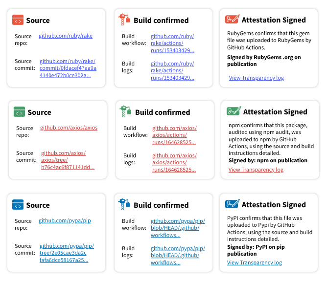
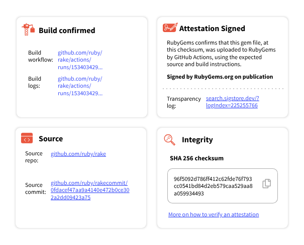
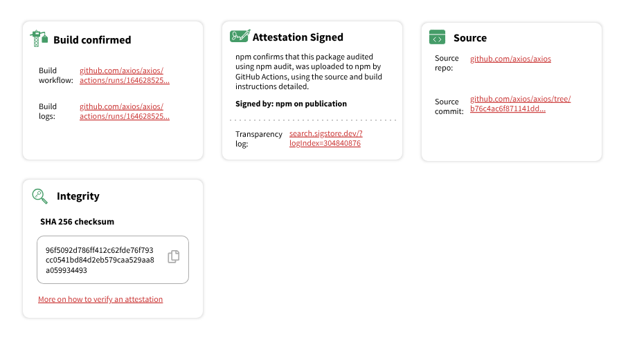
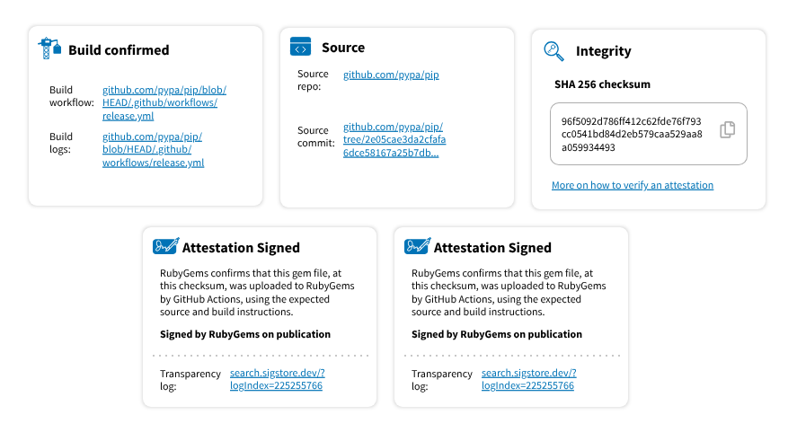
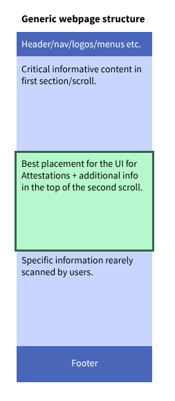
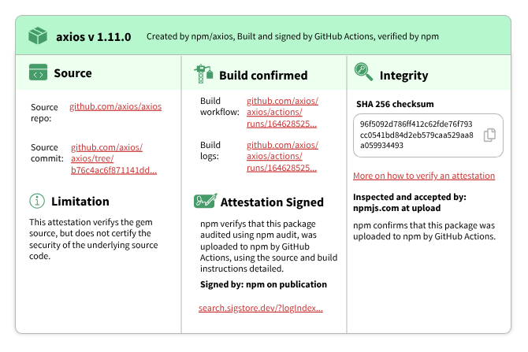
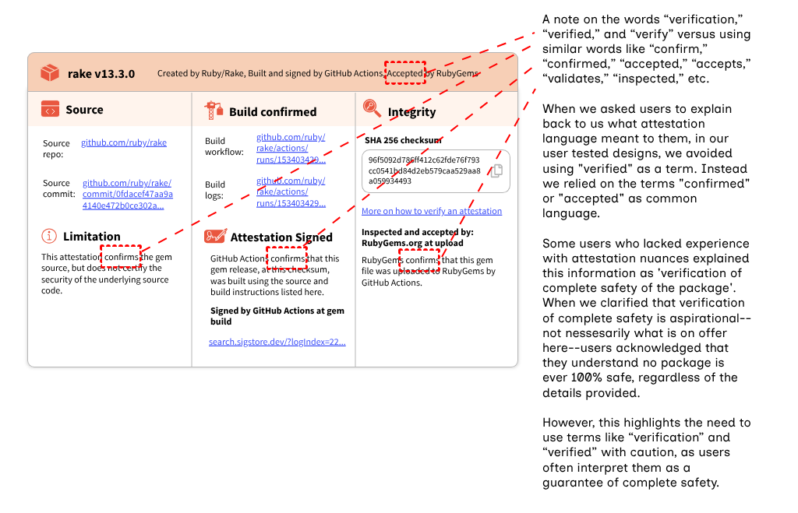
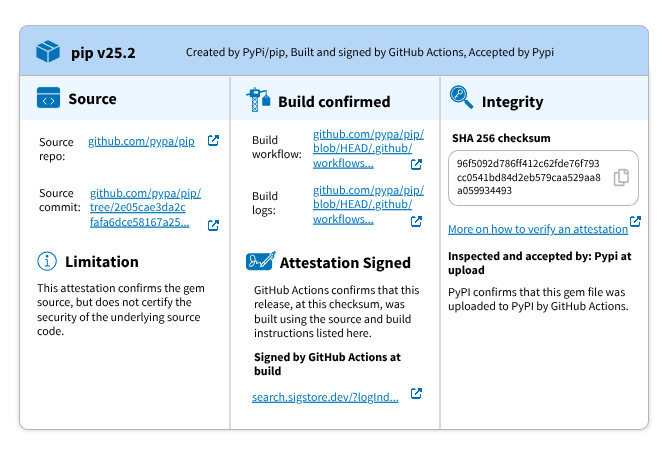
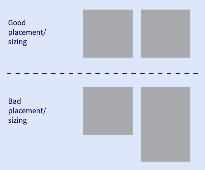


# スタイルガイド: レベル AA - 中程度 {#style-guide-level-aa---medium}

スタイルガイドのこのセクションでは、パッケージレジストリで証明（アテステーション）の情報を表示するための、中程度（レベル AA）の要件を定めます。ねらいは、パッケージのビルドの完全性に対するユーザーの安心感と信頼を強めることです。

これらの推奨事項を実装することにしたパッケージリポジトリは、ユーザーインターフェースの中で、より多くの表示スペースを割り当てる必要があります。この方式は、最低限（レベル A）の要件で導入した情報を広げるものです。追加の詳細、ソースへのリンク、そしてユーザーが証明とその関連情報を調べてよりよく理解するための分かりやすい道筋を、あらかじめ見える形で示します。

中程度の要件にはバリエーションがあります。

1. **3 枚カードのレイアウト**: 情報を、互いに区別された「カード」（モジュール）として示します。各カードには、アイコン、見出し、ラベル付きのソースへのリンク、そして（該当する場合は）ドキュメントへのリンクが含まれます。このバリエーションは通常 3 枚のカードで構成しますが、必要に応じてカードを追加できる柔軟さがあります。

2. **4 枚（大きめ）カードのレイアウト**: 表示スペースに余裕のあるパッケージレジストリ向けに設計したバリエーションで、より大きなカードのデザインを使います。通常 4 枚のカードで構成しますが、必要に応じてカードを追加できる柔軟さがあります。

ユーザーテストでは、バリエーション 1 と 2（3 枚カードと 4 枚カードのレイアウト）が、含まれているリンクとあわせて、ユーザーがパッケージの安全性・セキュリティ・完全性を調べる助けとして最も効果的だと分かりました。

このプロジェクトのユーザー調査のメモについては、[証明のユーザーインターフェースの分かりやすさとユーザーの好みを評価することに焦点を当てたユーザーテストのメモ](https://github.com/ossf/wg-securing-software-repos/issues/66)をご覧ください。

_証明の情報を視覚化するための、中程度のレベル AA の要件を示す UI の例のスクリーンショット。この例ではボックスの幅 = 200px、高さ = 160px_

カードは、ほとんどのプラットフォームのメインページの幅に 3 枚が収まるように設計してあります。また、ボックスは積み重ねられます。たとえば、証明が 2 つ以上ある場合は、4 つ目のボックスを Source カードの下に置く、といった具合です。

ここに載っている詳細は、最小限のレベル A のコンポーネントを展開した状態と同じです。違いは、パッケージ名、バージョン番号、箱のアイコンが、ブラウザーとコードの括弧のアイコンと "Source" という見出しに置き換わっている点です。ユーザーにとっては、パッケージのアイコンと名前、そしてソースのアイコンと Source というラベルは、同じか、十分に近い意味を持ちます。また、リポジトリとソースコミットという関連情報が、ユーザーにとってこの見出しの文脈を補っています。

"build confirmed" と "verification" のような用語の使い分けについては、このスタイルガイドの後のほうで明らかにします。

ここでも、Build Confirmed カードには、（そのページやプラットフォームで入手できるバージョンの）ビルドコミットとビルドログが含まれます。これらの例のリンクは、リンク先として厳密に正確ではない場合があることにご注意ください。

Transparency log のリンクは、URL のままでも、ハイパーリンクでもかまいません。
ハイパーリンクについて詳しくは、このスタイルガイドのハイパーリンクのページにあります。

_証明の情報を視覚化するための、中程度のレベル AA の要件を、大きめの「ボックス」サイズで示す UI の例のスクリーンショット。この例ではボックスの幅 = 260px、高さ = 200px_

ここでも、これらのカードは積み重ねられるように、そして標準的なページレイアウトのメインコンテンツ領域の幅に 2 枚が収まるように設計してあります。たとえば、証明が 2 つ以上ある場合は、2 枚ずつの行を作れます。Source カードを Build Confirmed カードの隣に置き、Integrity カードは、隣を空けたまま 1 枚分のスペースに置くことも、好みに合わせてレイアウトの中央に置くこともできます。

これらのカードに含まれる情報は、3 枚のカードを 1 行に並べた前のページのバージョンと同じです。目立った違いは 1 つだけです。スペースに余裕があるので、Transparency Log のラベルとリンクを点線でゆるやかに区切り、証明との結びつきを保ちながら、独立した場所も持たせられます。

カードを横に 2 枚（ページの幅によっては 3 枚）並べ、残りをその下に積み重ねることで、証明のボックスの近くに、より多くの補助的な情報を載せられます。Integrity カードには、証明の検証に使う「チェックサム」と、ユーザーに情報と知識を提供するドキュメントへのリンクを含めるべきです。チェックサムについては、このスタイルガイドでさらに詳しく取り上げています。

ページ上の情報の間でチェックサムが重複するという、起こりうる、そして起こりやすい状況については、中程度の UI の大きなモックアップでも扱っています。手短に言えば、どのリンクや情報についても、重複はユーザーにとって問題になりませんでした。それどころか、リンクやチェックサムの詳細のように、一致しているはずのものが繰り返されていることは、良いことだと受け取られました。テストに参加したユーザー全員が、その結果としてページ全体の情報の正しさに、より安心感を持ったと報告しています。

_証明の情報を視覚化するための、中程度のレベル AA の要件を、大きめの「ボックス」サイズで示す UI の例のスクリーンショット_

ページの幅が 1 行に 3 枚のカードを許す場合の、大きめのカードサイズの例です。追加の Integrity カードは、その下の行に 1 枚だけで積み重ねています。

これは、証明に関連する情報が今後ここに追加されるかもしれないことを、ユーザーに示します。このデザインとレイアウトは、ユーザーには「使われていないスペース」があるようには見えませんでした。ただし、実装するときには、1 枚だけのカードを多く許すことには注意が必要です。カードが 1 枚しかなく、しかもページレイアウトの使える幅いっぱいに広げようとしていない場合、その情報は「取り残された」ように見えるからです。

_証明の情報を視覚化するための、中程度のレベル AA の要件を、大きめの「ボックス」サイズで示す UI の例のスクリーンショット_

適切であり、かつ十分なページ幅がある場合の例として、枚数の少ない行を、枚数の多い行の下で中央に寄せる配置があります。ここでは、1 行目に 3 枚、2 行目に 2 枚のカードがあり、少ないほうの行を左揃えにも右揃えにもしていません。（ここに示した例は、同じ証明を 2 つ使っており、表示の向きを示すことだけを意図しています。）

_中程度のレベル AA の UI を、ウェブページ上のどこに置くのが理想的かを示すスクリーンショット_

中程度のレベル AA の UI の配置は、最低限のレベル A の UI と同じです。

つまり、パッケージが何をするのかという重要な機能面の情報の後で、かつ「社会的証明（social proof）」の情報、すなわちダウンロード数、メンテナーやコントリビューターのプロフィールや名前、そのほかのパッケージの来歴（プロベナンス）情報に、できるだけ近い位置です。

テストした中程度の UI コンポーネントはもう 1 つあります。分かりやすさのために記録として残していますが、実装はもう推奨していません。このデザインは、中程度の要件の以降のページで取り上げます。

_すべての情報を、区切りのある 1 つの大きなコンテナボックスに収めた、中程度のレベル AA の UI のスクリーンショット_

この大きなカードのデザインをテストして分かったのは、パッケージレジストリのページを訪れるユーザーは誰でも、そこに載っている情報に対して、ある程度の警戒心や疑いを持っているということです。ユーザーは最初から用心深く、信頼も揺らいだ状態でやって来ます。その背景には、次のような考えがあります。「こういうページには、誰でも好きな文章や情報を載せられるんですよね？　メンテナーでも、レジストリでも、誰でも。だから、出どころを見て自分で確かめないかぎり、情報は基本的に信用しません。」

つまり、"( ! ) caution..." のようなメッセージは、ユーザーがすでに持っている警戒心を強め、リスクを明らかにはするものの、気をつけるよう促す単純な警告 1 つを超えると、たいていは煩わしく、役に立たないことが多いのです。ページ全体で、警告や注意の類のメッセージの数を減らすことをお勧めします。

カードコンポーネントのこのバリエーションは、こうした詳細を、通常のページ情報とは異なる（外部の）、はっきり独立したコンポーネントに見せたいレジストリやプラットフォームのために、独自性のあるデザインを保っています。色やブランドデザインの要素は、プラットフォームごとにスタイルを設定できます。

このバージョンは、説明文と、証明の限界についての警告も強調しています。具体的には、証明とは何かということと、示された情報をユーザーがどう解釈しうるかということの違いです。

言葉づかいについて: これは、説明の文章が最も多い最小限のデザインです。免責事項のような文章をできるだけ多く載せたいプラットフォームには、このデザイン（または、このスタイルガイドの後のほうで説明する最高水準の AAA）をお勧めします。

_すべての情報を、区切りのある 1 つの大きなコンテナボックスに収めた、中程度のレベル AA の UI の、注釈付きのスクリーンショット_

"verification"、"verified"、"verify" という語と、"confirm"、"confirmed"、"accepted"、"accepts"、"validates"、"inspected" などの似た語の使い分けについての注記です。

証明に関する言葉が自分にとって何を意味するかをユーザーに説明し直してもらうにあたり、ユーザーテストに使ったデザインでは、"verified" という用語を使うことを避けました。代わりに、一般的な言葉として "confirmed" や "accepted" という用語を使いました。

証明の微妙な点に慣れていないユーザーの中には、この情報を「パッケージが完全に安全であることの検証」だと説明した人もいました。
完全な安全性の検証は目指すべき理想であって、ここで提供されているものとは限らないと私たちが説明すると、ユーザーは、どれだけ詳細が示されていても 100% 安全なパッケージなど存在しないと理解している、と認めました。

とはいえ、このことは、"verification" や "verified" のような用語を慎重に使う必要があることをはっきり示しています。ユーザーはこれらを、完全な安全性の保証と解釈することが多いからです。

ここのカードで使っている "confirms"、"accepts" などの言葉でも、何が起きているのかはユーザーにはっきり伝わります。つまり、いくつかの主体が詳細を確認し、ビルド来歴や想定される出どころといった特定の側面について、一定の立場からの「お墨付き」を表明しているということです。それでも、ユーザーは「verified（検証済み）だ！」という思い込みに飛びつきがちです。"verification" という用語は、この語があることでユーザーがパッケージを完全に安全だと思い込むリスクを、プラットフォームが受け入れる用意がある場合にだけ使うべきです。

_区切りのある大きなコンテナボックスを使った、中程度のレベル AA の UI を PyPI の配色で示すスクリーンショット_

ユーザーに最も好まれなかった中程度のデザインです。

ユーザーに UI を見せるときは、すべてのデザインの順番を入れ替えました。最高水準を最初に見たユーザー、最低限を最初に見たユーザー、中程度を最初に見たユーザーがいます。このデザインはユーザーからの評価が最も低かったので、推奨からは外しますが、分かりやすさを保つために、スタイルガイドの中に記録として残しています。

このカードは、より簡素な軽量版と中程度版でテストした、最も役に立つ情報をすべてまとめようとしたものです。レジストリやプラットフォームに新しいページやセクションを導入する AAA の要件を別にすれば、これがこのコンポーネントの最も包括的なバージョンだと私たちは考えています。このデザインは、証明の具体的で欠かせないデータを含め、最も関連が深く、互いに結びついた情報をすべて見せることを目指しています。食品の名前のすぐ隣に「栄養成分表示」があるようなもの、と言えるでしょう。

次の、注釈付きのウェブページ全体の UI の例を、お好みの画像ビューアで開いてください。この画像は 4.6MB、キャンバスが 14052x14542 ピクセルと大きなものです。.pdf ファイルもあります。

* [ui-development-medium-ui-version-a-level.png](images/ui-development-medium-ui-version-a-level.png)
* [ui-development-medium-ui-version-a-level.pdf](https://repos.openssf.org/attestations-style-guide/images/ui-development-medium-ui-version-a-level.pdf)

注釈付きの画像ファイルには、次の文章が含まれています。

* メインのページセクションの幅に収まる、同じ大きさのカードを 1 行に並べた例です。
* この例では、チェックサムや SHA のコンテナがデザインに含まれていないことに注意してください。
* カードを 2 x 2 で横に並べて積み重ねた例です。この例では、Integrity セクションにチェックサムや SHA の情報が含まれており、デザインの見た目の釣り合いを取る助けになっています。
* プラットフォームは、1 つのコンテナを 2 枚分のスペースにまたがらせることもできます。ボックスのコンテナの幅や高さに厳密な決まりはありませんが、高さの異なるコンテナを隣り合わせにしないことを強くお勧めします（下の図を参照）。

_中程度のレベル AA の UI の、良い配置と悪い配置を示すスクリーンショット_

注: カードは、ページの使える幅いっぱいに広げることも、情報を無理なく読み取れるのに必要な最小限の幅だけを占めるようにすることもできます。

標準のカード 3 枚の下に、1 枚のカードを積み重ねた例です。横に並んだこの 3 枚のカードも、載せる情報に必要な最小限の幅を占めています。

---

次: [最高水準の UI 要件（レベル AAA）](level-aaa.html)

