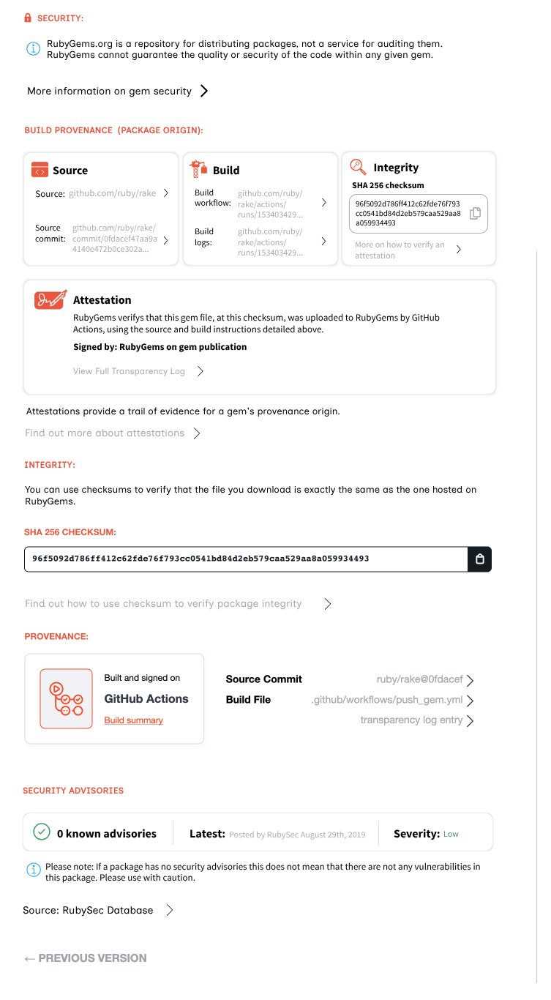
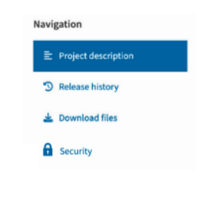
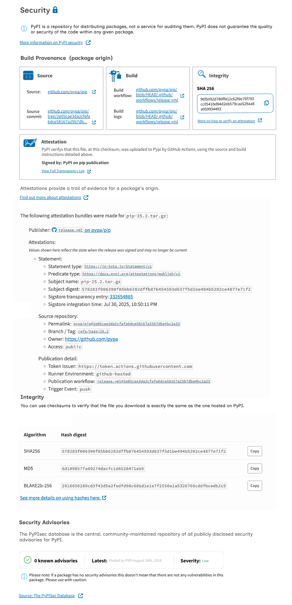
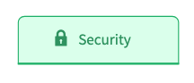
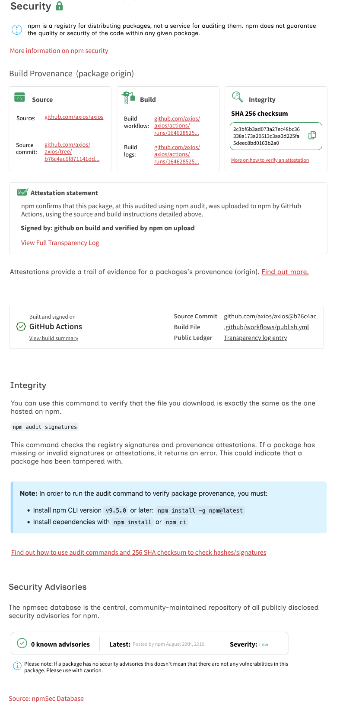
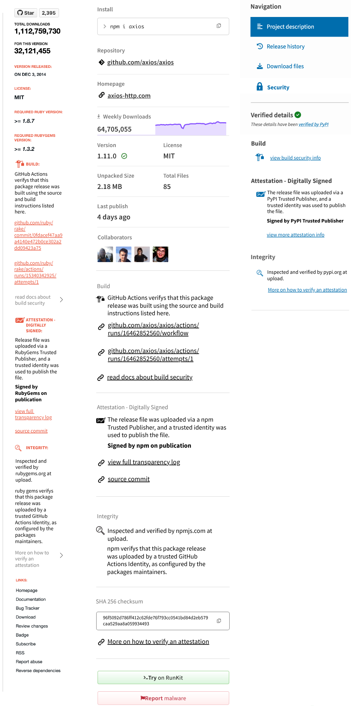
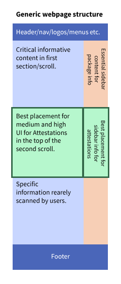


# スタイルガイド: レベル AAA - 最高水準の要件 {#style-guide-level-aaa---highest-requirements}

UI の推奨事項のうち最も高い水準では、レジストリのサイトやプラットフォームにあるサイドバーの一画に証明（アテステーション、attestation）の情報やリンクを加えます。あわせて、新しいセキュリティページ、タブ、またはセクション（プラットフォームの構成によって異なります）も設けます。より詳しい情報を求めるユーザーがサイドバーの内容を操作したときに、このセキュリティの内容へリンクでたどり着けるようにします。

## セキュリティページのセクション {#security-page-section}

独立した専用のセキュリティセクションまたはセキュリティページを設ける UI デザインは、すべてのユーザーペルソナで最も良いテスト結果になりました。セキュリティの専門家（Security Experts）、実務重視の開発者（Pragmatic Developers）、たまたま利用するユーザー（Incidental Users）のいずれも、「使うパッケージについて安全でセキュアな選択をするのに役立つ情報」を探すとき、期待する情報が見つかる場所として専用のセキュリティページが最適だと感じていました。これにはアテステーションの情報も含まれます。

ユーザーは、ふだんの作業の流れのなかでは、情報を集めるときに最初に立ち寄るのがセキュリティセクションではないことを認めていました。たいていは、パッケージの概要説明、ソースリポジトリへのリンク、社会的証明（social proof）にあたる指標から見始めます。しかし、セキュリティや安全性に関する情報を確認する段階になると、セキュリティセクションはすぐにそれと分かりました。そのため、パッケージやビルドのセキュリティの詳細を見るのにここが正しい場所なのかどうか、ユーザーが迷うことはありませんでした。こうした情報がレジストリやプラットフォームのメインのページに置かれていた場合、ユーザーは、アテステーションや関連するデータがその文脈で何を意味するのかを判断するために、余分に頭を使わなければなりませんでした。アテステーションの文言にざっと目を通しながら、「自分はいまどこにいて、この情報は正確には何についてのものなのか」と自問することに、貴重な数秒を費やしていたのです。専用のセキュリティページやセクションのなかでは、その手間がなくなりました。

また、セキュリティページがあることで、そのレジストリ／プラットフォームとパッケージがセキュリティに「真剣に取り組んでいる」という印象を受けた、と述べたユーザーも何人かいました。さらに、将来セキュリティの詳細や助言を追加する必要が出てきたときに、追加の情報を載せる余地にもなります。

レジストリやプラットフォームによっては、専用のセキュリティページを追加できるページやタブがないこともあります。その場合は、下の RubyGems のパッケージの例のように、ほかのセクションの下にセキュリティセクションを加えれば、ほかと区別でき、サイドバーの内容からリンクする先としても十分です。セキュリティページのセクションをどのようにテストしたか、またユーザーがそう考えた理由については、以降の節で詳しく述べます。

_最高水準であるレベル AAA の要件に沿ってアテステーションの情報を可視化した UI の例と、セキュリティページ全体の内容の例を示すスクリーンショット_

PyPI のように左側にメニューがあるレジストリやプラットフォームでは、そこにセキュリティページを追加できます。

PyPI は複雑な例です。テストでユーザーが「セキュリティ」の情報だと考え、このセクションに含められそうな情報が、さまざまにたくさんあるからです。最善の助言は、既存の情報のうち何をセキュリティページに移し、何をセキュリティページからリンクするのかを、プラットフォームが十分な情報にもとづいて判断することです。

_最高水準であるレベル AAA の要件に沿ってアテステーションの情報を可視化した UI の例と、セキュリティページ全体の内容の例を示すスクリーンショット_

_最高水準であるレベル AAA の要件に沿ってアテステーションの情報を可視化した UI の例と、セキュリティページ全体の内容の例を示すスクリーンショット_

npm のようにナビゲーション用のタブバーがあるレジストリやプラットフォームでは、そこにセキュリティページを追加できます。

私たちがテストした npm の例では、パッケージのページに README が丸ごと表示されていることが多く、README に含まれていない情報を見つけるには何ページ分もスクロールする必要がありました。どの情報がパッケージのメンテナーによって書かれたもので、どの情報がレジストリから提供されたものなのか、ユーザーが混乱する場面もありました。提案として出たものの UI では検討しなかった案の 1 つに、公開日を含めて、内容に作成者の名前を添えるというものがあります。たとえば、「This security page was last updated on [ DATE ] by npm to include [ DETAILS ].」（このセキュリティページは、[ 詳細 ] を含めるために [ 日付 ] に npm によって最終更新されました）のようにします。

_最高水準であるレベル AAA の要件に沿ってアテステーションの情報を可視化した UI の例と、セキュリティページ全体の内容の例を示すスクリーンショット_

_最高水準であるレベル AAA の要件に沿ってアテステーションの情報を可視化した UI の例と、セキュリティページ全体の内容の例を示すスクリーンショット_

**サイドバー - 最小限**
ページにサイドバーがある場合、そこにはたいてい、パッケージを使うかどうか、あるいはパッケージが安全かどうかをユーザーが判断するのにとても役立つ情報がすでに載っています。ダウンロード数、リリース、ソースコードやリポジトリへのリンク、コントリビューターが並ぶのは、ふつうこの場所です。これらの情報は、安全性やセキュリティにとって重要なだけでなく、ユーザーがパッケージを調べるときに全般に役立ちます。

サイドバーは、ユーザーがアテステーションの情報を見たいと考える第一の場所にもなりました。ただしユーザーは、アテステーションやセキュリティの内容によって、ほかの重要な情報が下へ押しやられるのは望まないと述べていました。また、サイドバーにある詳しい文章や長い文章を読むことも、あまりなさそうでした。

したがって、最小限のサイドバーは、専用のセキュリティページまたはセクションと組み合わせる場合にだけ使うべきです。サイドバーのリンクは、ページ上の関連するセキュリティ情報への「ブックマーク」のように働き、クリックされるとユーザーを該当のセクションへ案内したり、そこにフォーカスを当てたりします（たとえば、サイドバーの「Build confirmed」がクリックされたら、セキュリティページの「Build confirmed」のセクションにフォーカスを当てるべきです）。まれに、レベル AA の要件を満たすスタイルのコンポーネントを、UI のこの場所で最小限のサイドバーと並べて任意で使えることもあります。

**サイドバー - 最大限**
最大限のサイドバーは、セキュリティページを見て回ることがあまりなさそうで、セキュリティ情報を深く掘り下げたり、サイドバーのリンクでそこへ誘導されたりするのを望まないユーザーのために設計した UI です。サイドバーには数語の文字だけが載っている（完全な文が載っていることはまずない）というのが一般的な期待なので、こうしたユーザーは比較的まれです。それでも、レジストリやプラットフォームが、サイドバーにできるだけ多くの情報を表示したい、あるいはセキュリティページの内容の一部もそこに含めたい、と考える場面はあります。

専用のセキュリティセクション、ナビゲーションバーのタブ、左側メニューのタブについては、下を見てください。私たちは「security」という語を、錠のアイコンを付けた場合と付けない場合の両方でテストしました。このセクションが何をするものなのかについてユーザーの理解を補強できるため、錠のアイコンを付けたほうが好まれました。「ロックされた」セクションだと誤解されることはありませんでした。

レジストリやプラットフォームの視覚的なスタイルによっては、アイコンを使えない場合もあるでしょう。その場合は、錠のアイコンを省いてもかまいません。

_最高水準であるレベル AAA の要件に沿って、とくにサイドバーの内容を可視化した UI の例を示すスクリーンショット_

すでに述べたとおり、アテステーションの内容をサイドバーに配置するときは、次のような欠かせない一般的な情報よりも上に表示するべきではありません。

* ソースコードリポジトリへのリンク
* ホームページ／URL（ある場合）
* リリース
* ライセンス
* ダウンロード数（週間など）
* バージョン番号
* ファイルサイズ
* 最終公開日
* メンテナー／コントリビューターのプロフィール画像や名前

ふつうは、こうしてもアテステーションの情報はサイドバーの最初のスクロール範囲内に表示されます。理想を言えば、欠かせない情報を押しのけない範囲で、できるだけ上に配置するべきです。

サイドバーのなかで展開できるセクションもいくつかテストしましたが、ユーザーの評価は良くありませんでした。サイドバーの情報は、そのまま表示されているか、内部または外部のリンク先へ移動するものであって、サイドバーのなかで開いたり閉じたりするものではない、というのが一般的な期待です。

_最高水準であるレベル AAA の UI で、良い配置と悪い配置を示すスクリーンショット_

次に挙げる、注釈付きの UI の Web ページ全体の例は、お好みの画像ビューアーで開いてください。この画像は大きく、3.2MB、キャンバスは 10982x5000 ピクセルです。.pdf ファイルもあります。

* [ui-development-highest-ui-version-a-level.png](images/ui-development-highest-ui-version-a-level.png)
* [ui-development-highest-ui-version-a-level.pdf](https://repos.openssf.org/attestations-style-guide/images/ui-development-highest-ui-version-a-level.pdf)

注釈付きの画像ファイルには、次の文章が含まれています。

* これらのサイドバーのデザインは情報量の多い版で、アテステーションの理解を助ける、関連のある役立つ詳細をすべて表に出しています。これらのサイドバーは、単体で「軽量／中程度」の実装として機能させることも、レベル AA の要件のカードコンポーネントと組み合わせることも、このページで説明しているレベル AAA のセキュリティページの実装の一部として使うこともできます。
* これらのサイドバーのデザインには、私たちがテストしたユーザーが、最も役に立つ情報をすでにサイドバーのなかに見つけていたという事実が強く反映されています。ユーザーは、既存のレジストリのページでふつうサイドバーに載っているソースコードやリポジトリへのリンクと並んで、「透明性の社会的な網」（social web of transparency）にあたる情報を優先していました。ただし、ページ本体の内容の場合と同じように、ユーザーは、アテステーションの情報と補足情報がこれらの重要な一般情報の下に来ることは望んでいませんでした。ふつうは、こうしてもアテステーションの情報は、ほとんどのページでファーストビュー、つまり最初のスクロール範囲内に表示されます。
* RubyGems のページレイアウトのようなサイドバーでは、狭い幅に情報が詰め込まれて見えることが分かります。サイドバーの幅は、この例より狭くしないことをおすすめします。これより狭い場所に文の長さの内容を書くと、開発者が読んで理解するのが難しくなるからです。
* これらのサイドバーのデザインは情報を最小限にした版で、アイコン、見出し、リンクという必須の要素だけに絞っています。
* 最小限のサイドバーのデザインにあるリンクは、パッケージごとの専用のセキュリティページへユーザーを案内しなければなりません。この方法は、長い README の内容や大量のパッケージ情報を載せているページで、とくにうまく機能します。こうすると、サイドバーの内容をページのより上のほう（ただし README より前とは限りません）に表示でき、追加の詳しい情報を持つコンポーネントは README の後ろに配置できます。
* 最小化しない唯一の情報は、アテステーションの文言（パッケージに複数ある場合は、選ばれた 1 つのアテステーションの文言）です。この文言は、アイコンと、セキュリティセクションにあるより詳しい情報へのリンクを添えて、必ず全文を表示しなければなりません。
* npm のセキュリティページへは、新しいタブ「security」から移動します
* PyPI のセキュリティページへは、左側の新しいタブ「security」から移動します
* RubyGems のセキュリティページは、メインのページにある RubyGems 用の新しいメインのセクション見出しから見られるようにします
* セキュリティの見出しの下には、短く、しかも見た目に圧迫感のない文があります。ユーザーがすぐに説明文書を読み込みたいと思ったときに、gem のセキュリティについてのより詳しい説明文書へ、ここからすぐに案内します。
* RubyGems には一部のパッケージについて別々のページがないので、最後の見出しの下に「Security」という新しい見出しを加えることで、セキュリティに関連する情報を、アテステーションの情報とあわせてここに配置できます。
* ここのレイアウトは、最低水準と中程度の UI デザインで見覚えがあるかもしれません。このセクションも同じ「コンテナーボックス」の UI に従っており、ページの幅に合わせて無理のない数を横一列に並べています。
* ここで欠かせないのは、アテステーションの部分に視覚的な優先度を与えるために、アテステーションがページの全幅を占めるか、ビルド、ソース、完全性（integrity）よりも広い幅を占めることです。アテステーションの部分をビルド、ソース、完全性より先に置かないのは、これらのセクションのほうが広く知られ、理解されているからです。アテステーションは、これらの情報との関係のなかでこそよく理解されます。そのため、ビルド、ソース、完全性を先に置き、そのあとにアテステーションを置くことで、ユーザーは、ビルドのセキュリティと、それを誰がどのように検証しているのかについて考える準備ができます。
* 「build provenance」（ビルドの来歴（プロベナンス））という見出しは、アテステーションと補足情報がユーザーに何を伝えようとしているのかについて、ユーザーがもっと文脈を必要としていると分かったときに加えたものです。この見出しによって、意味がはっきりします。
* 同じように、アテステーションのコンテナーボックスの下にはメッセージがあり、アテステーションの情報がユーザーに何を伝えようとしているのかを、さらに明確にしようとしています。
* 完全性のセクションには、来歴やパッケージのセキュリティ上の手続きに関連する、ほかの既存の情報があればそれを載せます。ここでは、一部の情報がページのなかで重複することがあります。
* このスタイルガイドのほかの箇所でも述べているとおり、重複はユーザーにとって問題ではありません。一致するはずの重複した情報が実際に一致しているかぎり、重複はパッケージの情報に対するユーザーの信頼をかえって高めます。
* ここの最後のセクションは、セキュリティ勧告のセクションです。信頼できる出どころの勧告を取り込んで表示する手段がプラットフォームにあるなら、このセクションを設けるべきです。プラットフォームがセキュリティ勧告のデータベースを利用できないなら、このセクションは省くべきです。
* このセクションをいちばん下に置いているのは、ユーザーテストで、ユーザーがこのセクションにとても好意的だったからです。あまりに反応が良く、パッケージのセキュリティ情報を確かめようとして、ほかの情報を見るのをやめてしまうことがよくありました。このセクションの優先度を下げて低い位置に置くのは、ユーザーがこのセクションだけに注目してしまうのを防ぐためです。
* 以降のそれぞれのデザインにも、最小限の情報のサイドバーがあることに注意してください。
* サイドバーにあるこれらのセクションは、クリックされたときに、メインのページのセキュリティセクションにある該当のセクションへ「フォーカス」を当てるか、ユーザーをそこへ移動させるか、またはその両方を行うべきです。
* PyPI では、メニューにセキュリティのタブがあります
* プラットフォームやレジストリによって、セキュリティのタブやページに取り込める詳しいセキュリティ情報は異なります
* npm では、メニューのナビゲーションにセキュリティのタブがあります

---

次: [UI の詳細](ui-details.html)

