
# PyPI での実装事例 {#pypi-implementation-case-study}

* 著者: [Nicole Harris](https://github.com/nlhkabu)
* 追加: 2026 年 10 月

Python Package Index（PyPI）は、[最高水準の UI 要件（レベル AAA）](level-aaa.html)に従って、このスタイルガイドの推奨事項を実装した最初のパッケージレジストリです。この取り組みには、次のことが含まれます。

1. 専用のセキュリティタブを導入する
2. パッケージのメインのページを組み替えて、来歴（プロベナンス、provenance）の状態をサイドバーに表示する
3. ユーザー向けの説明文書を更新して、セキュリティ専用の手引きを含める

実装の進み具合は [Warehouse の issue トラッカー](https://github.com/pypi/warehouse/issues/19950)で管理され、[PyPI のブログ](https://blog.pypi.org/posts/2026-07-22-ui-updates/)で告知されました。

このページでは、次のことを記録します。

1. PyPI が作ったもの
2. 実装を支えるために追加で行ったユーザーリサーチ
3. その過程からほかのレジストリが学べること

## 固有の課題 {#unique-challenges}

### ファイル単位のアテステーション {#attestations-at-the-file-level}

このスタイルガイドの推奨事項の大半は、パッケージに、パッケージ単位の証明（アテステーション、attestation）が 1 つだけあることを前提にしています。PyPI はそのようには動きません。1 つのリリースはファイルの集まりであり、それぞれのファイルが自分のアテステーションを持っています（または持っていません）。そのため、リリースが混在した状態（たとえば、一部のファイルには完全にアテステーションがあり、ほかのファイルにはアテステーションがない状態）になることがあり、表示できるような「このパッケージにはアテステーションがある」という単一の状態はありません。

つまり PyPI は、スタイルガイドのアテステーションのコンポーネントを、プロジェクトのページにそのまま置くわけにはいきませんでした。チームは、リリース単位で何を表示するか（要約）、ファイル単位で何を表示するか（詳細）、そして両者の食い違いをどう扱うかを決める必要がありました。

PyPI はさらに、スタイルガイドに明示されていない境界的な事例や警告の状態をどう扱うかも決める必要がありました。次のようなものです。

1. **Incomplete provenance（不完全な来歴）:** リリースのなかに、アテステーションのあるファイルとないファイルがある場合
2. **Inconsistent provenance（一貫しない来歴）:** リリースのなかに、来歴の異なるファイルがある場合（たとえば、一部のファイルはあるリポジトリや構成から、ほかのファイルは別のリポジトリや構成から来ている）
3. **Loss of provenance（来歴の喪失）:** 以前のリリースには来歴／アテステーションがあったのに、現在のリリースにはない場合
4. **Change of provenance（来歴の変更）:** 公開元のリポジトリや構成が、リリースの間で変わった場合

どの場合も、こうした異常には正当な説明がつくことがあります（たとえば、メンテナーが公開やコードホスティングのプラットフォームを移行した）。しかし、これらのパターンは、侵害の可能性を強く示す兆候でもあります。これを伝えるには、慎重な釣り合いが求められます。適切な注意を払って行動するようユーザーに警告しつつ、ワークフローを正当な理由で変更したメンテナーを不当に不利に扱ったり、責めたりしないようにする必要があります。

### そのほかのセキュリティの合図 {#other-security-signals}

PyPI はアテステーションのほかにも、すでに別のセキュリティの合図を表示しており、再設計ではそれらも考慮する必要がありました。

1. **メタデータの検証:** PyPI は、メンテナーが提供したメタデータの一部をアップロード時に確認します。これまでは、それらをサイドバーのなかで「Verified details」（検証済みの詳細）と「Unverified details」（未検証の詳細）というセクションに分けていました。しかし、このラベルは対象の範囲があいまいで、ユーザーが（メタデータだけでなく）リリース全体が確認されたのだと思い込んでしまうことがありました。

2. **あとからアップロードされた配布ファイル:** PyPI は以前、リリースの日からいつまででも、メンテナーが新しい配布ファイルをアップロードできるようにしていました。PyPI は 2026 年 7 月に、[新しいファイルを追加できる期間を 14 日間とする仕組みを導入](https://blog.pypi.org/posts/2026-07-22-releases-now-reject-new-files-after-14-days/)しましたが、UI では、とくにアテステーションの異常を文脈のなかで捉えやすくするために、過去の「あとから追加されたファイル」を目立たせる必要が残っていました。

## 初期のデザイン、調査、検証 {#initial-designs-research--validation}

私たちは、新しいデザインを作り、磨き上げ、クリックできるプロトタイプとして組み立てました。これには次のものが含まれます。

1. セキュリティの合図がよりよく伝わるように、[パッケージの詳細ページを更新する](https://github.com/pypi/warehouse/issues/19951)
2. [来歴の状態をサイドバーに表示する](https://github.com/pypi/warehouse/issues/19975)
3. アテステーションを、[新しいセキュリティタブ](https://github.com/pypi/warehouse/issues/20069)と[ファイルの詳細ページ](https://github.com/pypi/warehouse/issues/20185)の両方に表示する

その後、これらのデザインをユーザーリサーチで評価しました。次のものを行いました。

1. [サイドバーの再設計についてのアンケート](https://github.com/pypi/warehouse/issues/20058)
2. [3 つのペルソナ](https://github.com/ossf/wg-securing-software-repos/issues/70)を代表する 6 人の参加者への[ユーザーインタビュー](https://github.com/pypi/warehouse/issues/20111)

アンケートでは、パッケージの信頼性と適合性を評価するときの重要度で、メタデータ（来歴を含みます）に順位を付けてもらいました。

インタビューでは、クリックできるプロトタイプをユーザーに操作してもらい、来歴の 6 つの状態をテストしました。

1. 完全な来歴
2. PyPI Publish と SLSA Build Provenance の両方のアテステーションがある、完全な来歴
3. 来歴なし
4. 部分的な来歴
5. 変更された来歴
6. ファイルごとの異常

主な発見:

* **来歴は高く評価されている:** アンケートでは、来歴の重要度は、適合性と信頼性の両方で全体の 2 位でした
* **「検証済み」と「未検証」の詳細を分けるより、有用性で整理するほうがよい:** アンケートの回答者の過半数は、PyPI が検証したメタデータを優先することを役に立つと感じていました。その一方で、777 人中 146 人が、「Verified」と「Not verified」のセクションを分けると、正当だが未検証のメタデータが不必要に疑わしく見えると答えました。インタビューの参加者は 6 人全員が、メタデータを有用性で整理し、検証のバッジやラベルをその場に添える形を好みました。
* **用語のなじみ具合には差がある:** インタビューの参加者 6 人のうち 4 人は、来歴をおおまかな意味（「それがどこから来たのか」）で理解していました。しかし 2 人はこの用語にまったくなじみがなく、平易な言葉による説明が必要であることが浮き彫りになりました
* **警告は、即座の拒否ではなく調査を促す:** インタビューの参加者は、来歴の異常や警告を、プロジェクトやリリースを使うのをやめるべき自動的な合図としてではなく、さらに調べるための、行動につながる文脈として扱いました

ユーザーからのフィードバックは、実装の前に最終的なデザインへ取り込みました。たとえば、ファイルごとの異常のデザインは取りやめました。参加者は、*リリース内のファイルどうし*の比較を分かりにくいと感じ、*リリースどうし*の比較のほうが役に立つと感じたからです。その結果、来歴の警告はリリース単位でまとめて示しています。リリース内のファイルを比べる「Inconsistent provenance」でさえ、リリース単位の 1 つの警告として示し、ファイルをリポジトリと構成ごとにまとめています。

## 実装 {#implementation}

以下のスクリーンショットは、PyPI での実装を記録したものです。

### 来歴がない場合 {#no-provenance}

リリースに来歴がない場合は、次のようになります。

1. セキュリティタブが表示されます
2. 来歴に固有のメタデータは、サイドバーに含まれません

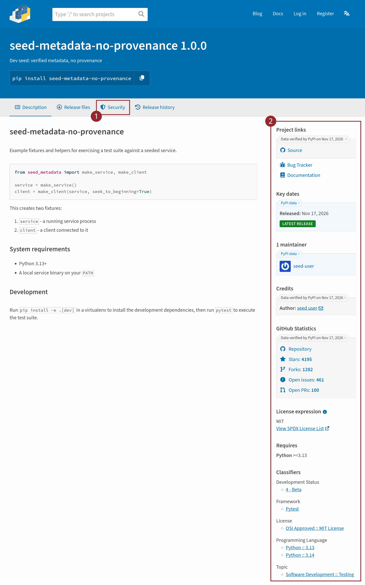

ユーザーがセキュリティタブを選ぶと、次のものが表示されます。

1. 来歴とアテステーションの説明:

   > 来歴は、ファイルがどこから来たのかを説明するものです。PyPI では、来歴はアテステーションを通じて共有されます。アテステーションは、ビルドや公開の詳細についての検証可能な記録を提供します。詳細、制限事項、注意点を見る。

2. 「No provenance found」（来歴が見つかりません）という通知:

   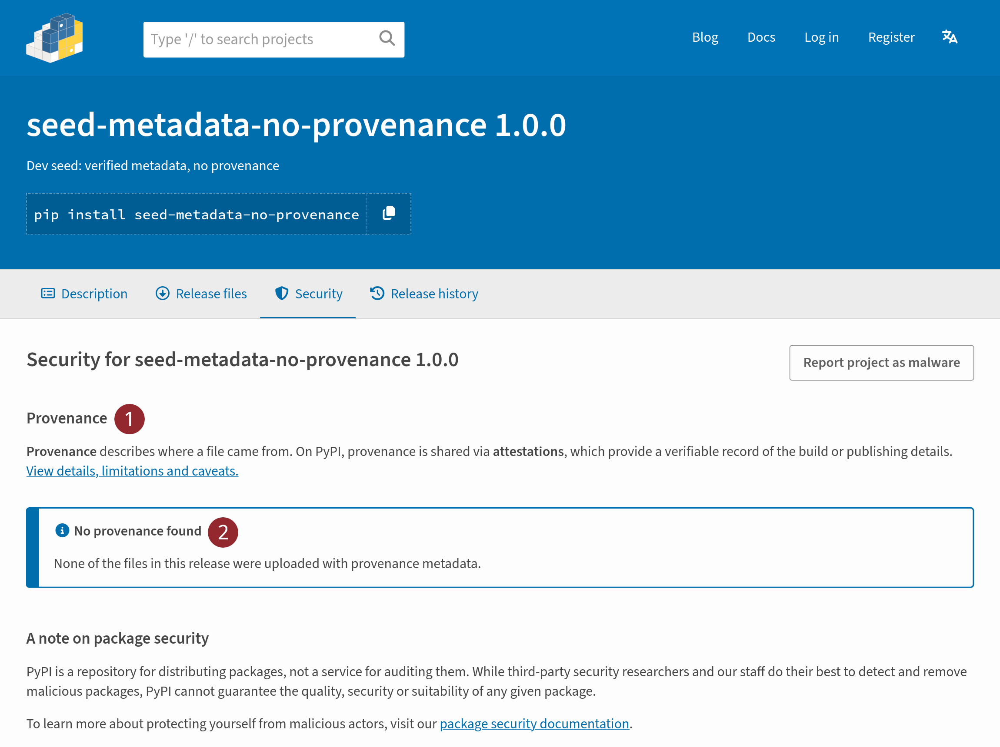

この方法なら、メインのタブに「No provenance」という否定的な状態を表示してメンテナーを不利に扱うことなく、来歴とアテステーションという概念をユーザーに紹介できます。

### 来歴がある場合 {#with-provenance}

リリースに来歴のメタデータが含まれている場合、それは UI のいくつかの箇所に表示されます。

**プロジェクトの説明のタブ:**

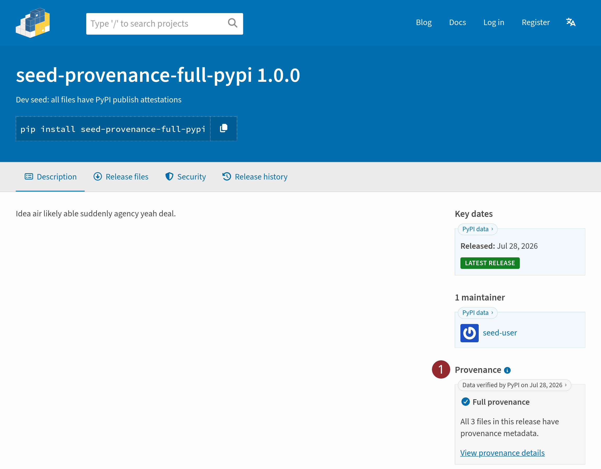

1. サイドバーに「Provenance」の状態が表示され、より詳しい情報のあるセキュリティタブへリンクします

**セキュリティタブ:**

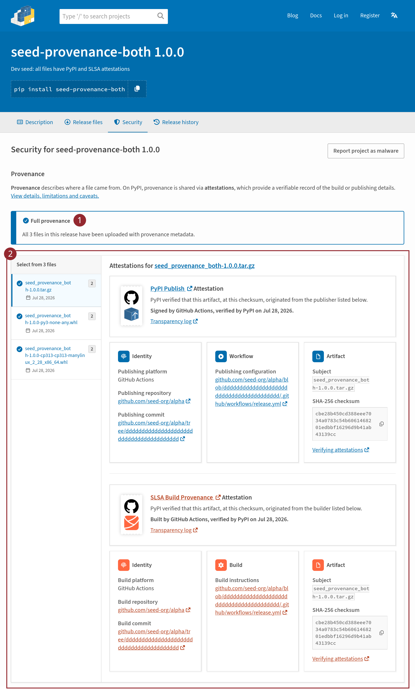

1. *リリース*の来歴の状態が、ページの上部近くの通知で強調されます
2. ファイルごとのアテステーションのビューアーが表示され、ユーザーは各ファイルのアテステーションを詳しく確認できます。PyPI と SLSA の両方のアテステーションがある場合は、色、アイコンの表現、説明で区別されます。

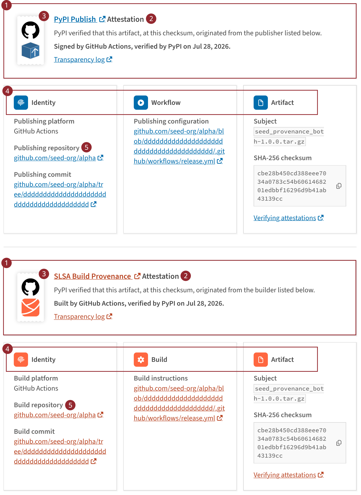

アテステーションの表示は、アテステーションの種類ごとに調整しています。

1. アテステーションのブロックは、スタイルガイドでは[ほかの列の*下*に表示することを推奨しています](level-aaa.html)が、見出しの役割を持たせるために、ほかのメタデータの*上*へ移しました。これにより、それぞれのアテステーションのアイデンティティ、ワークフロー、成果物の詳細がひとまとまりになり、アテステーションの種類を見出しとして使えます。
2. アテステーションのタイトルには、アテステーションの種類（つまり PyPI か SLSA か）が表示され、predicate の定義へリンクします
3. アテステーションの種類の横にロゴを置いて、どのサービスがアテステーションをビルドまたは署名したのかを示します。ロゴの組み合わせには、GitHub + PyPI、GitHub + SLSA、GitLab + PyPI、GitLab + SLSA、Google Cloud + PyPI、Google Cloud + SLSA があります。
4. 「Identity」「Workflow/Build」「Artifact」のラベルは、アテステーションの種類ごとに表示される具体的なデータを反映します
5. 小見出しは、アテステーションの種類に合わせて変えています。たとえば、リポジトリは、PyPI Publish のアテステーションでは「Publishing repository」と表示されますが、SLSA のアテステーションでは「Build repository」と表示されます。

**ファイルのタブ:**

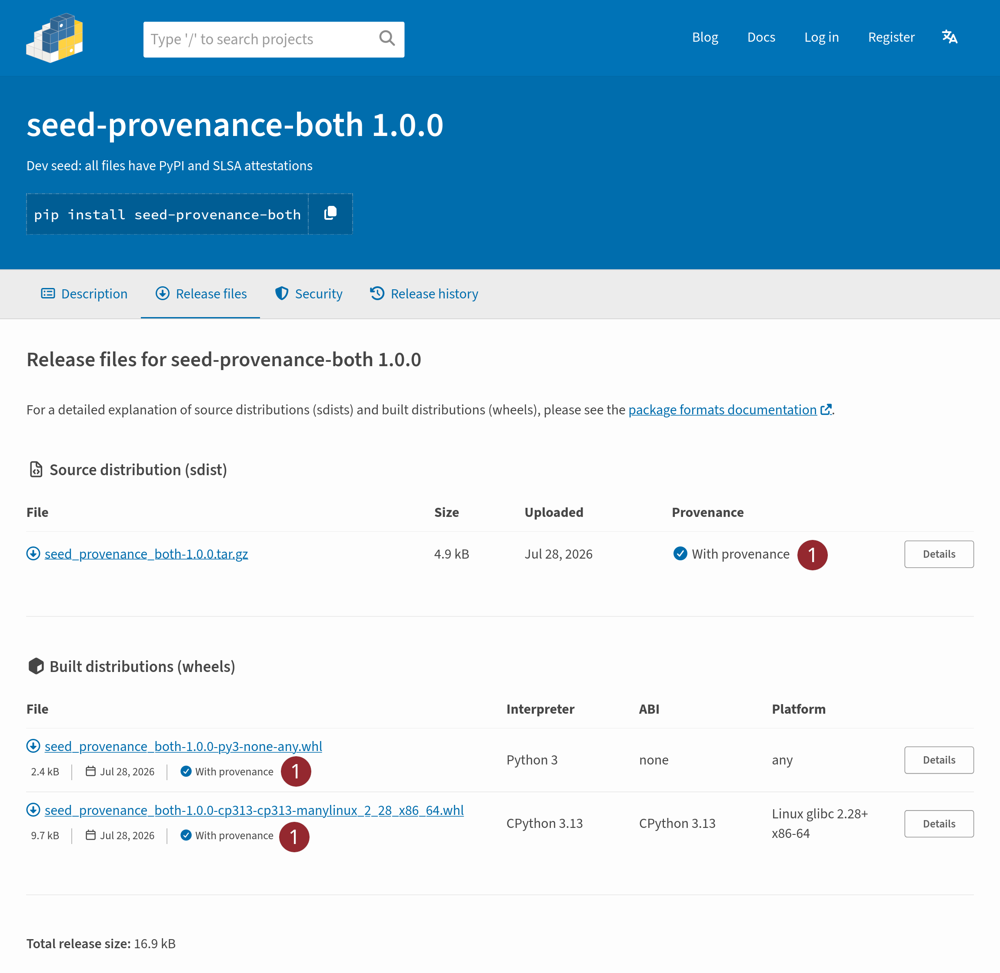

1. 来歴のあるファイルには、セキュリティタブのアイコンの表現に合わせた青いチェックマークとともに、「With provenance」の印が付きます

アテステーションのブロックは、ファイルの詳細ページ（「Details」ボタンから開きます）にも含まれます。

### 警告の状態 {#warning-states}

リリースの来歴に異常が検出されると、それは画面の各所に表示されます。

1. ページ上部のリリースのステータスバー[^1]
2. プロジェクトの説明のサイドバー
3. セキュリティタブ
4. ファイルのタブとファイルの詳細ページ

[^1]: リリースのステータスバーは、プロジェクトやリリースが PyPI の管理者によって隔離された場合など、ほかの重大な状態を表示するのにも使われます。その場合は隔離の状態が優先され、来歴の警告はこの上部のバーには表示されません。

#### 不完全な来歴 {#incomplete-provenance}

一部のファイルにしかアテステーションがない場合は、リリースのステータスバーとサイドバーの来歴のパネルに「Incomplete provenance」の警告が表示され、より詳しい情報へリンクします。

セキュリティタブでは、来歴のメタデータなしでアップロードされたファイルがいくつあるかを通知で説明し、リリースのファイルの内訳を示す棒グラフを添えます。

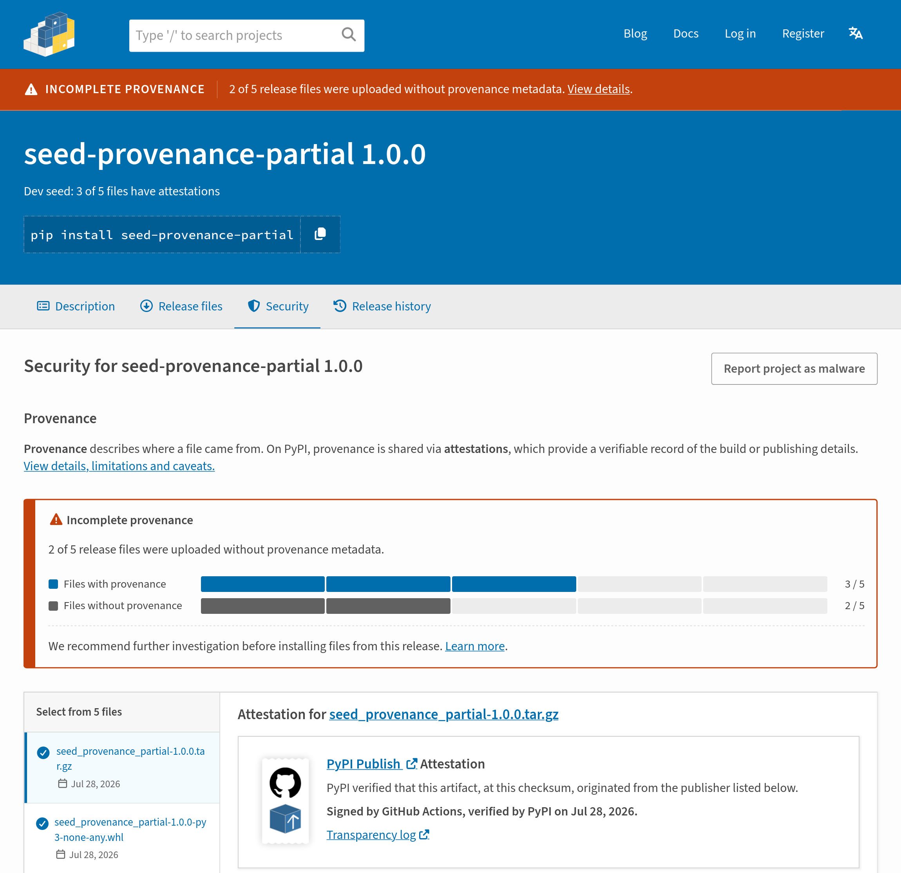

ファイルのタブでは通知が表示され、個々のファイルに「With provenance」または「Without provenance」の印が付きます。

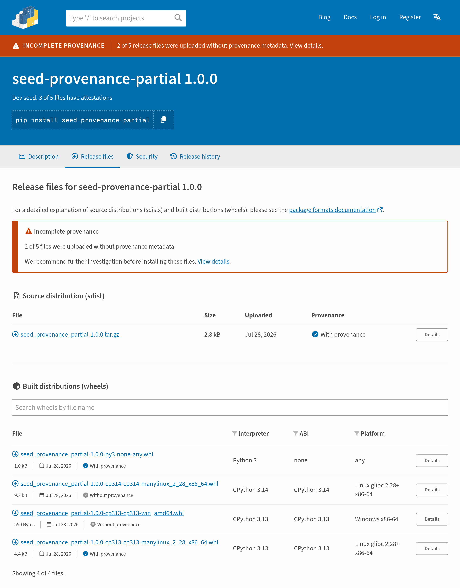

#### 一貫しない来歴 {#inconsistent-provenance}

同じリリースのなかのファイルが、異なるリポジトリや構成から来ている場合は、上部のバーとサイドバーのパネルに「Inconsistent provenance」の通知が表示されます。

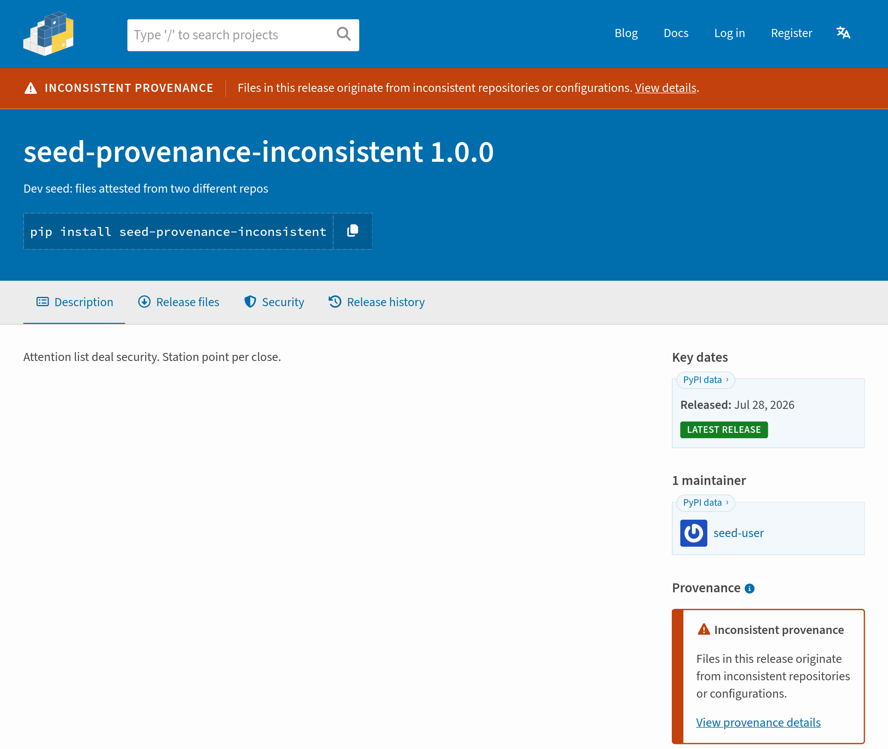

セキュリティタブでは、成果物の全体で検出された別々のリポジトリと構成を、ファイルをそれを生成したリポジトリと構成ごとにまとめて、一覧で示します。

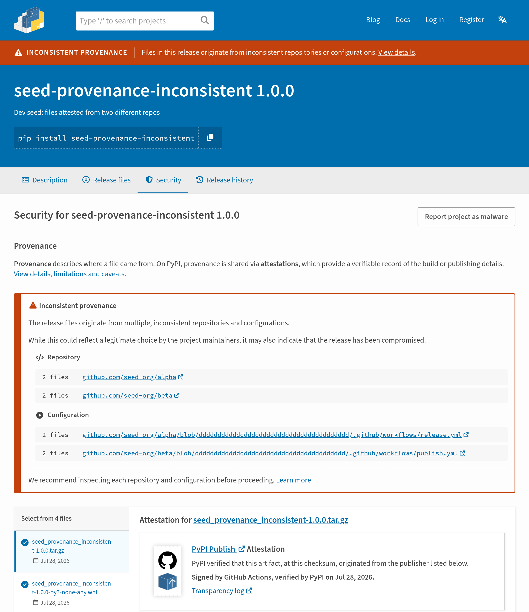

ファイルのタブでは、リリースのファイルが異なるリポジトリまたは構成から来ていることを通知で知らせます。

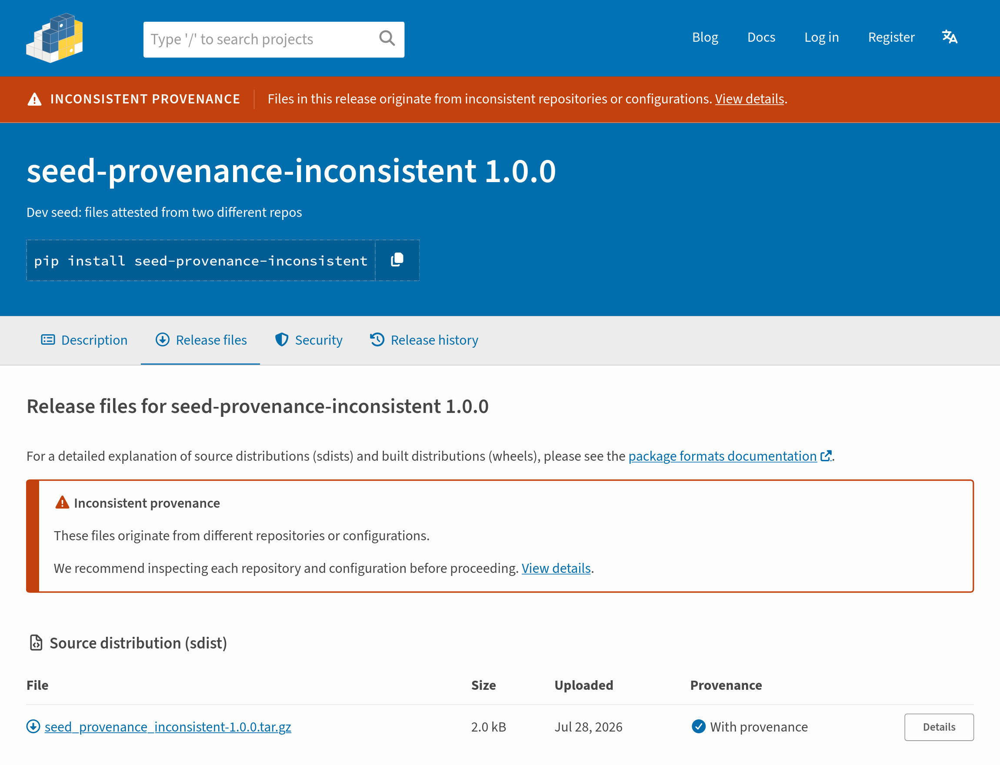

#### 来歴の喪失 {#loss-of-provenance}

リリースの間で来歴が失われた場合[^2]、UI は上部のバーとサイドバーに「Loss of provenance」の通知を表示します。

[^2]: あるリリースのどのファイルにもアテステーションがなく、それより前の 14 日以内に作られた以前のリリースにはアテステーションがあった場合に、そのリリースには「Loss of provenance」が表示されます。リリースの件数ではなく時間にもとづく期間を選んだのは、攻撃者がプロジェクトに大量のリリースを流し込んで警告を出なくするのを防ぐためです。

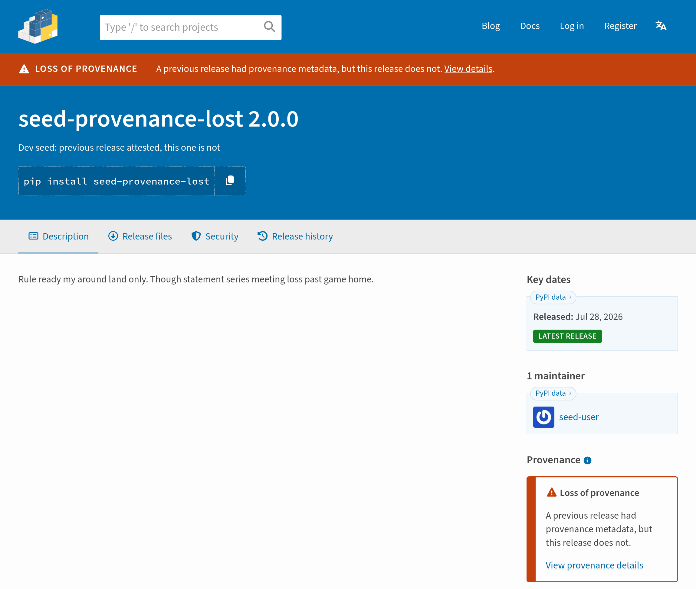

セキュリティタブでは、以前のリリースには来歴のメタデータがあったのに現在のリリースにはないことを通知で説明し、リリースの比較表を含めます。

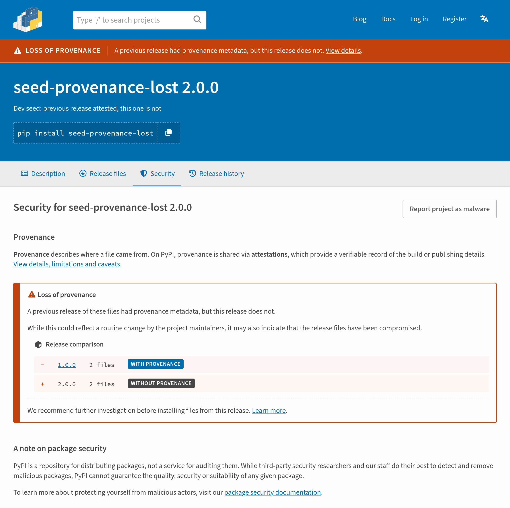

ファイルのタブには、より詳しい情報のあるセキュリティタブへユーザーを案内する通知が加わります。

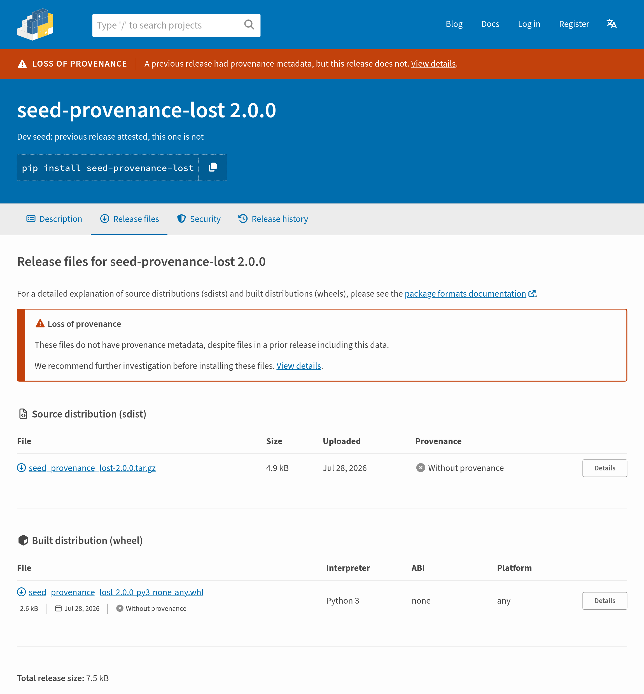

#### 来歴の変更 {#change-of-provenance}

公開元のリポジトリや構成がリリースの間で変わった場合は、リリースのステータスバーとサイドバーに「Change of provenance」の警告が表示されます。

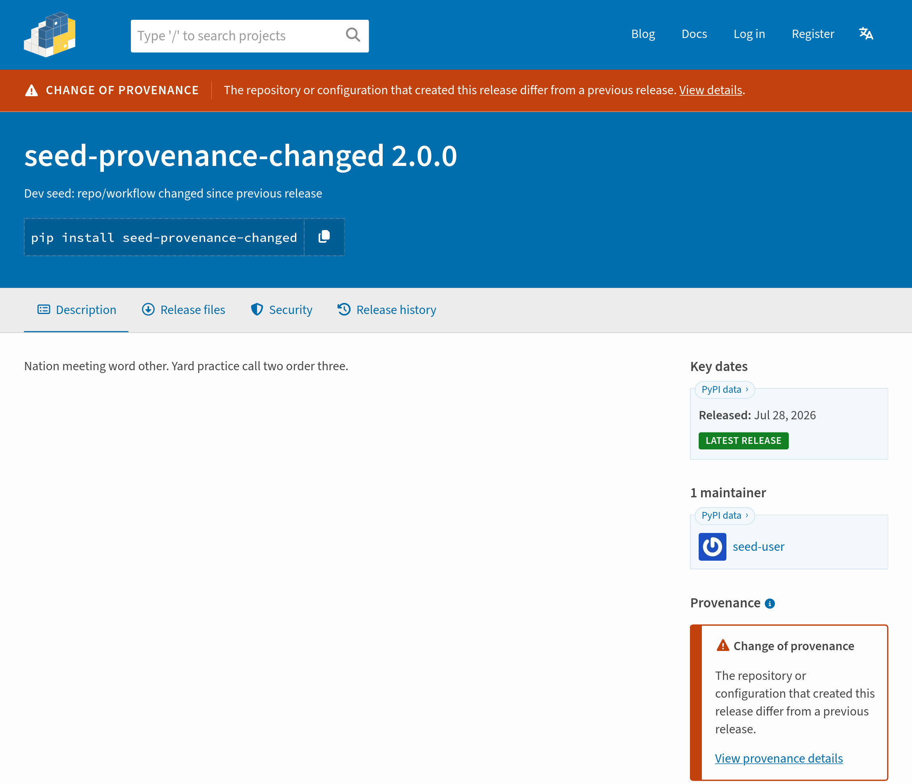

セキュリティタブでは、このリリースを作成したリポジトリと構成が以前のリリースと異なることを通知で説明し、差分の比較を添えます。

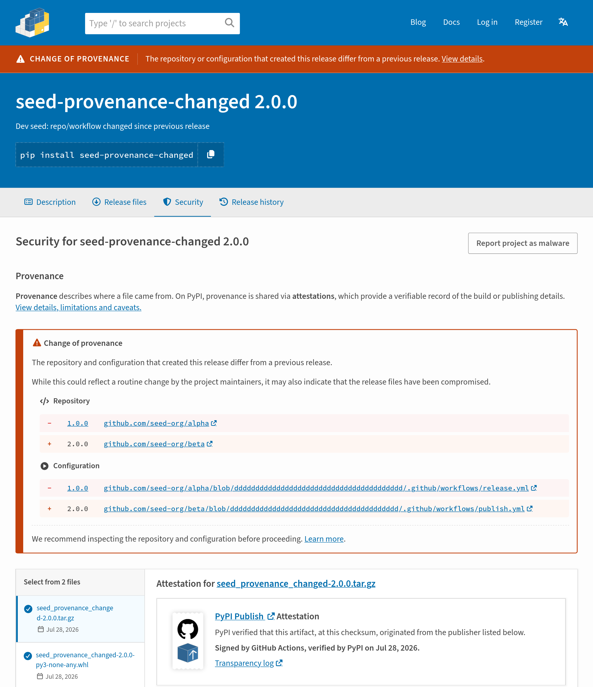

ファイルのタブには、より詳しい情報のあるセキュリティタブへユーザーを案内する通知が加わります。

#### あとから追加されたファイル {#files-added-late}

リリースの最初のファイルから 14 日を超えてファイルがアップロードされた場合は、リリースのステータスバーのほか、ファイルのタブとファイルの詳細ページにも「File added late」の警告が表示されます。セキュリティタブには、より多くの文脈を示すために「Upload timing」のセクションが加わります。PyPI は現在、[14 日を過ぎると新しいファイルを拒否する](https://blog.pypi.org/posts/2026-07-22-releases-now-reject-new-files-after-14-days/)ので、この警告は過去のリリースにだけ表示されます。

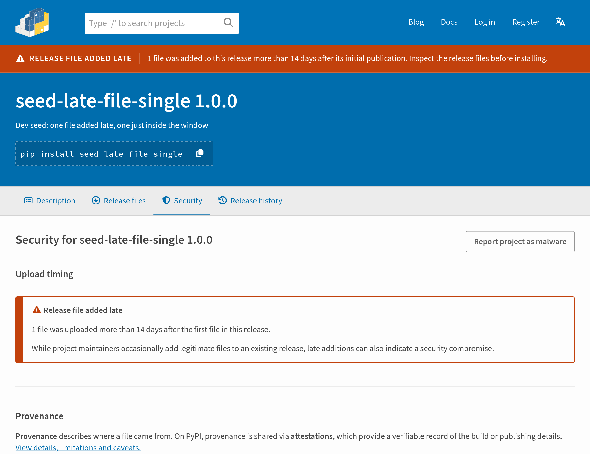

リリースに、あとから追加されたファイルの異常と来歴の異常の*両方*がある場合、リリースのステータスバーには来歴の警告だけが表示されます。ファイルのタブとファイルの詳細ページでは、使いやすさを高めるために、警告を 1 つの複合的な通知にまとめます（たとえば「Loss of provenance, with files added late」）。

## 説明文書の更新 {#documentation-updates}

UI の変更を支えるために、私たちはこのガイドの[説明文書についての推奨事項](documentation.html)に従って、[ユーザー向けの説明文書を更新しました](https://github.com/pypi/warehouse/pull/20550)。

* これまで 1 つの `/help` ページのなかで管理していた内容を、役割ごとに構成したユーザー向けの説明文書へ移しました
* パッケージの利用者に向けて、「Using PyPI」の下に新しい **Package Security** のセクションを加えました。ここでは、来歴とアテステーションを、ソースコードの評価、チェックサムの検証、よくある攻撃、脆弱性の報告とあわせて説明しています

## ほかのレジストリへの推奨事項 {#recommendations-for-other-registries}

### 「来歴」と「アテステーション」の意味を定義する {#define-what-provenance-and-attestations-mean}

これらの用語が業界の標準的な知識になるまでは、レジストリが明確に定義するべきです。PyPI では、次の説明をセキュリティタブに加え、更新した説明文書へ直接リンクしています。

> 来歴は、ファイルがどこから来たのかを説明するものです。PyPI では、来歴はアテステーションを通じて共有されます。アテステーションは、ビルドや公開の詳細についての検証可能な記録を提供します。詳細、制限事項、注意点を見る。

### 「verified」、チェックマークのアイコン、緑色のスタイルは慎重に使う {#be-judicious-about-using-verified-checkmark-icons-or-green-styling}

[レベル AA の推奨事項](level-aa.html)に記したとおり、ユーザーはこうした目印についてすぐに結論へ飛びつき、肯定的なセキュリティのバッジがあればパッケージは 100% 安全だと思い込むことがある、と私たちは気づきました。インタビューの参加者 6 人のうち 2 人は、「verified」とは PyPI のチームがリリースのソースコードを手作業で監査したという意味だと思い込んでいました。

「verified」、チェックマーク、緑色のバッジを使う場合は、その対象の範囲を明示するよう気をつけてください。たとえば、私たちは検証済みのメタデータに次のようなラベルを付けました。

> Data verified by PyPI on \<date\>（PyPI が \<date\> に検証したデータ）

これにより、検証されたのは*データ*であって、リリース全体やコードベース全体ではないことがはっきりします。

### セキュリティの合図は重要だが、有用性より優先するべきではない {#security-signals-are-important-but-should-not-supersede-utility}

セキュリティ情報をほかの何よりも優先することは、ユーザーが望んでいたことではないと分かりました。ユーザーは、セキュリティに関係するかどうかにかかわらず、判断に関わる事実をまず探していました。この発見は、[このスタイルガイドのほかの推奨事項](level-aaa.html)と一致しています。

### 警告は、ユーザーがさらに調べられるだけの文脈を示すべきである {#warnings-should-provide-enough-context-for-users-to-investigate-further}

ユーザーはふつう、Web ページの文章を隅々まで細かく読むのではなく、ざっと目を通します。警告は、次の条件を満たすときに、ユーザーに立ち止まるよう促すことが分かりました。

1. 視覚的に十分強調されている（私たちの警告は、濃いオレンジ色に警告のアイコンを添えたスタイルにしました）
2. 次に取れる具体的な行動を含めて、十分な文脈を示している

### 公開の場でデザインする {#design-in-the-open}

デザインとプロトタイプはすべて、公開でフィードバックを受けるために Warehouse の issue トラッカーで共有しました。また、主要な変更はそれぞれ [TestPyPI](https://test.pypi.org/) に先行して反映し、[フィードバックを寄せられる issue](https://github.com/pypi/warehouse/issues/20267) へユーザーを案内しました。この進め方によって、境界的な事例の不具合が表に出て、行動につながるフィードバックが集まり、私たちはプロジェクトを締めくくる前にそれらに対処しました。

公開の場でデザインし、変更を段階的にリリースしたことは、ユーザーが変化になじむ助けにもなりました。今後の変更を事前に見て、早い段階でフィードバックを寄せることで、関わっているという感覚と、コミュニティのものだという意識が育まれました。

---

戻る: [スタイルガイドの概要](../attestations-style-guide.html)

