
# スタイルガイド: UI の詳細 {#style-guide-ui-details}

## スタイルガイド: アテステーションのコンポーネント {#style-guide-attestations-component}

全体として、ここに挙げた証明（アテステーション、attestation）の文言は、どれもテストで良い結果になりました。アテステーションの客観的な言い回しを表すものとして、技術的に 100% 正確ではないかもしれないことは承知しています。私たちは、権威を連想させる言い回し、つまりパッケージのビルドに関するすべてが期待どおりだったことを「approve」（承認する）、「verify」（検証する）、「validate」（妥当性を確認する）、「confirm」（確認する）と述べる文言を、ユーザーテストにかけました。

私たちがテストしたユーザーは、流し読みするか、細かく読むかのどちらかになる傾向がありました。どのユーザーも、こうした種類の文言をおおむね理解し、そのパッケージがより安全で、より「公式」なものだと思える助けになるという点で意見が一致していました。これは、ダウンロード数が多くないパッケージや、社会的な証明や信頼の輪（web of trust）による強い裏付けがないパッケージで、とくに重要でした。

ユーザーが説明してくれた、小規模でニッチなパッケージの場面では、アテステーションの重要度がずっと高くなりました。また、アイコンがアテステーションを理解する助けになったという点でも、テストしたユーザーの意見は全員一致していました。これらの UI のモックアップで使ったアテステーションの文言は、最も字義どおりで正確な文言ではないかもしれません。最も正確なアテステーションの主張の文言は、テクニカルライターが書くことをおすすめします。

レジストリ／プラットフォームがアテステーションをできるかぎり目立たせたい場合は、全幅のボックスコンテナーを使った UI をおすすめします。

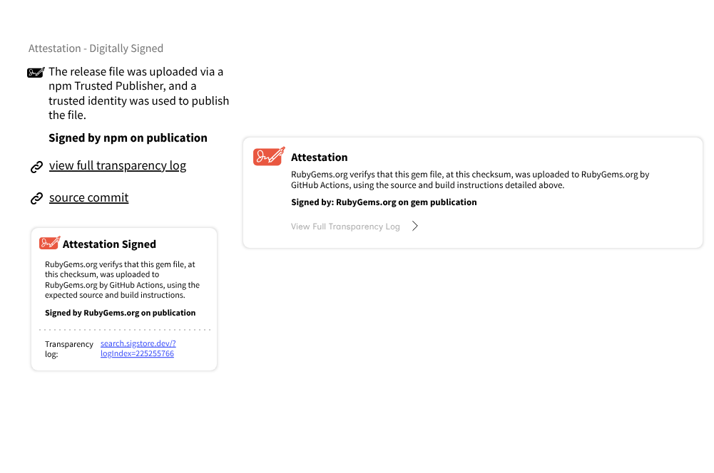
_UI のアテステーションのコンポーネントを単体で示したスクリーンショット_

## スタイルガイド: ビルドのコンポーネント {#style-guide-build-component}

ビルドのコンポーネントは、アテステーションに関係する情報のなかで、私たちがテストしたユーザーが役に立つと述べた最も重要なものでした。

この情報がほかの場所やソースリポジトリそのものからも得られることには、すべてのユーザーが同意していました。それでも、アテステーションの近くにあることで、より早く簡単に見つけられ、ビルドのアテステーションの文言の目的と結び付けやすくなりました。

モックアップに示したリンクは、パッケージが「Build commit/file」や「Build logs」に実際に使うものと厳密には同じではないかもしれません。しかし、技術とパッケージの知識がある人ならそこに置くはずのリンク先になっているかぎり、ユーザーは納得し、期待どおりの場所へ移動します。テストでは、最初のリンクに「Build commit」というラベルを付けていました。その後、例で使っているリンクをよりうまく説明するために、このラベルを「Build workflow」に変えました。

ビルドのコミット／ファイルやログを確認する作業は、私たちがテストしたセキュリティの専門家を除けば、どう取り組み、どう比べればよいのかを誰もが正確に知っているわけではありませんでした。そうしたユーザーにとっては、この情報があること自体が、そのパッケージのページが安全で、セキュアで、正当なものだという印象を生む助けになっていました。私たちがテストしたユーザーはたいてい、「Build」や「Build confirmed」のコンポーネントにあるリンクを、自分でソースリポジトリから見つけられるものと照らし合わせていました。

すべてのユーザーが、ビルドのセキュリティを評価する方法について、もっと説明文書や手引きがほしいと述べていました。

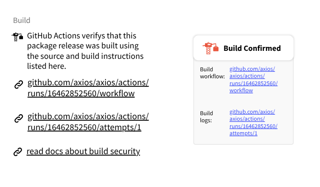
_UI のビルドのコンポーネントを単体で示したスクリーンショット_

## スタイルガイド: ソースのコンポーネント {#style-guide-source-component}

ユーザーは、ソースの情報をパッケージのページのほかの場所でも見つけられました。それでも、ソースリポジトリへのリンクとソースのコミットへのリンクが、ビルドの情報とアテステーションの近くにもあることで、ユーザーはこの情報を簡単に、しかもアテステーションを調べて理解するという文脈のなかで見つけられました。

ユーザーに関する発見をあらためて述べると、ユーザーは重複した情報を、気が散るものとも、紛らわしいものとも、安全性を下げるものとも感じていませんでした。「ここからでも、こっちからでも行ける」ので、重複していると役に立つと感じており、関連するリンクや説明文書を開くのが便利になっていました。

ソースは、アイコンの選択肢が 2 つある箇所の 1 つでした。「パッケージ」を表す箱か、ソースコードを表すブラウザーとコードの山括弧（`<>`）かのどちらかです。

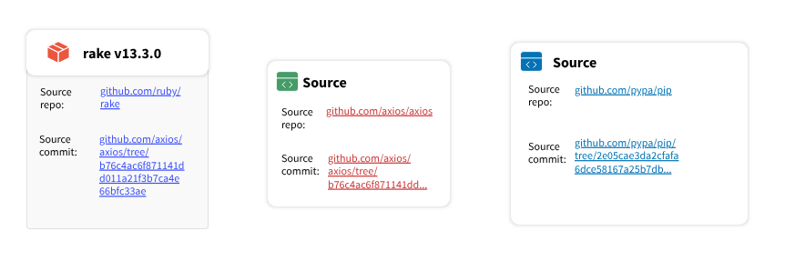
_UI のソースのコンポーネントを単体で示したスクリーンショット_

## スタイルガイド: 完全性のコンポーネント {#style-guide-integrity-component}

完全性（integrity）のセクションは、アテステーションのチェックサム、SHA-256、またはハッシュを表示する場所です。ここは、内部のデザインチームのなかで意見が分かれた部分でした。

私たちがテストしたユーザーは、チェックサムが何をするもので、どう使うのかをすでに理解しているかどうかに応じて、このセクションをおおむね役に立つ、あるいは興味深いと感じていました。理解しているユーザーは、ビルド、アテステーション、またはパッケージのセキュリティにより自信を持ち、チェックサムが載っていることを喜んでいました。意外なことに、テストしたユーザーは重複がありうることを気にしていませんでした。むしろ、重複は重要さの合図になっていました（一致すべき場面で値が一致し、正しいかぎりにおいてです）。

チェックサムが何に使われるのか、どう使うのかを知らないユーザーは、混乱するというより興味を持っていました。その情報が重要で、それが何なのかを学ぶ時間をかける気になれば役に立ちそうだ、と感じ取っていたのです。こうしたユーザーに必要だったのは、チェックサムの使い方についての分かりやすい説明文書や手引きへのリンクが、チェックサムの情報の近くに示されていることだけでした。ここでも、重複がありうることで混乱することはなく、「これは重要に違いない」という、欠かせない信頼の合図として受け取っていました。

「integrity」という語と虫眼鏡のアイコンは、何かが調べられているということをユーザーが理解する助けになり、ユーザーに勧める行動、つまりさらに詳しく調べることが何なのかをはっきりさせました。とはいえ、内部では、「integrity」はこの情報を正確に表していないかもしれないので、「Integrity」の代わりに「Inspect」を使ってもよいとも考えています。

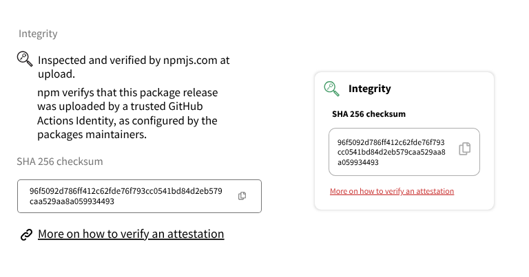
_UI の完全性のコンポーネントを単体で示したスクリーンショット_

## スタイルガイド: 信頼を示すそのほかの合図 {#style-guide-additional-signals-of-trust}

ユーザーとテストした信頼の合図のなかには、スタイルガイドの推奨事項に含めなかったもの、最小限にとどめたもの、最高水準の推奨事項にだけ登場するものが、ほかにもいくつかありました。その主な理由は、これらの要素は確実に実装できるようになるまでに追加の作業が必要であること（たとえばセキュリティ勧告）、あるいは、まだよく知られた用語や概念ではなく、それ自体について詳しい調査とユーザーリサーチが必要であることです。

セキュリティの専門家には評価が良かったものの、知識の少ない開発者のユーザーにはそうでなかった最初の要素は、SBOM（Software Bill of Materials、ソフトウェア部品表）と、[強化されたビルドのレベル](https://slsa.dev/spec/v1.1/levels)における SLSA3（Supply-chain Levels for Software Artifacts）に触れたセクションやバッジでした。

これらの用語は、知られている場合には、パッケージのセキュリティと安全性についてとても肯定的な合図になりました。知られていない場合、検索したり説明文書を見に行ったりして詳しく知ろうとするユーザーもいました。しかし、テストした小さなコンポーネントは、なぜこれらの概念を学ぶべきなのか、どんな利点があるのかについて、はっきりした動機を示せていませんでした。したがって、これらの要素は、ユーザーが関連する説明文書を探して理解できるようにする適切な手引きとあわせて、網羅的にテストする必要があります。

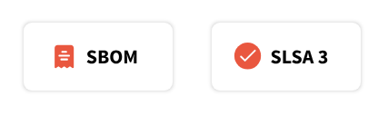
_信頼を示すそのほかの合図の UI のスクリーンショット_

既知のセキュリティ勧告は、アテステーションについての最高水準の UI の推奨事項に含めました。このコンポーネントはテストの結果が非常に良く、あまりに良かったために、ユーザーがほかの情報を無視してこちらを優先することがよくありました（これについては、最高水準の UI の要件でより詳しく取り上げています）。このコンポーネントが、なぜほかの情報よりも暗黙のうちにこれほど信頼されるのかを十分に理解するには、さらにユーザーリサーチが必要です。

アテステーションの文言に「trusted publisher」という語が使われていると、セキュリティの専門家であるユーザーはいくらか戸惑いました。ほとんどのユーザーは文言を額面どおりに受け取り、レジストリ、プラットフォーム、または GitHub のような別の主体が、「trusted publisher」というラベルを使うことで責任を引き受けているのだと考えていました。一方、私たちがテストしたセキュリティの専門家は、trusted publisher が正確には誰、あるいは何なのか、そして何を証明しているのかを知りたがりました。

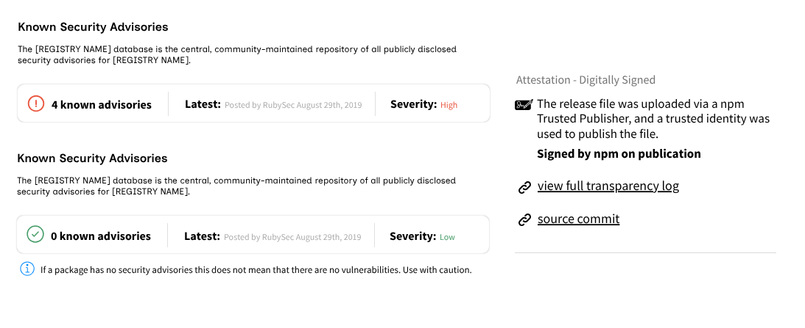
_信頼を示すそのほかの合図の UI のスクリーンショット_

チェックサムや SHA-256 を使うための段階を追った手順は、ごく初期のユーザーリサーチで挙がったものです。セキュリティの専門知識が少ないユーザーが知識を得て、SHA-256 のチェックサム、ハッシュ、鍵による署名を処理したり検証したりするための適切な手順をたどれるようにする方法としてでした。セキュリティにあまり詳しくないユーザーは、これが何なのかをまだ知らない場合、パッケージを調べている最中にその手順を学ぶ時間はないだろうと述べていました。その代わり、パッケージを選んだあとや、仕事のなかでやり方を学んだり教わったりする時間を与えられたときに、あらためて取り組むだろうとのことでした。

スタイルガイドの検討がさらに進むにつれて、このコンポーネントで実現しようとしていたこれらの手順は、長く、最小限の UI に収めるのが難しく、アテステーションにとってそれほど重要ではないと分かりました。

ハッシュを確認するための段階を追った手順を、展開できる形でまとめた、ごく初期のデザイン。

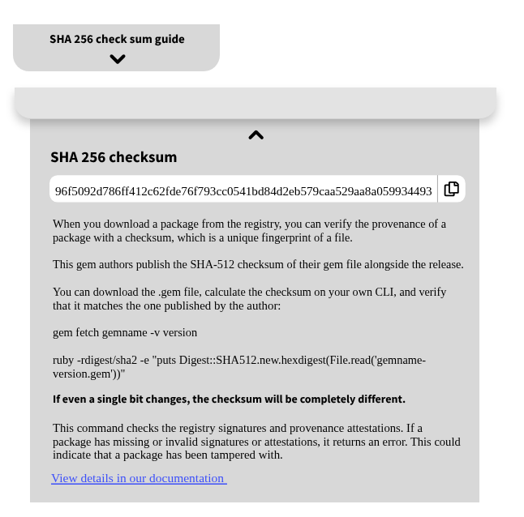
_信頼を示すそのほかの合図の UI のスクリーンショット_

## スタイルガイド: アイコン {#style-guide-icons}

アイコンは、アテステーションの取り組みのなかで決定的に重要な要素になりました。アイコンは、私たちがテストしたユーザーが、セクションや見出しが何を伝えようとしているのかを把握して理解する助けになり、ある行動を取るよう促したり、ある心構えを持たせたりしました。

アイコンについて全般に分かったことには、次のようなものがあります。

1. はじめのうち、アイコンに触れたユーザーはいませんでした。これはふつう、アイコンが使われているどの場所でも、奇妙だったり、変だったり、場違いに見えたりするものがなかったことを示しています。

2. ユーザーがアイコンに触れたときは、たいてい、添えられている見出しや文言に合っていると褒めていました。

3. ユーザーはおおむね、線や輪郭だけのアイコンよりも、塗りつぶしたアイコンを好みました。ただし、レジストリやプラットフォームはそれぞれ、全体の視覚的な美しさに最も合うアイコンのスタイルを使うべきです。

4. 塗りつぶすべきではなく、常に輪郭だけにしておくべき唯一のアイコンは、青い情報（i）アイコンです（モックアップに示したとおりです）。ユーザーは、このアイコンを塗りつぶした版を、役に立つというより、気が散って煩わしいと感じていました。それでも、アテステーションが何を検証でき、何を検証できないのかを明確にするうえで、これらの情報の文言を残しておくことは欠かせません。

5. ある参加者は、「Build」に使ったクレーンのアイコンを好まず、積みかけのレンガの壁のほうを好みました。壁は何かを組み立てていく過程を象徴しているのに対し、クレーンはパッケージをある場所から別の場所へ移すことを表しているように見えた、とのことです。ただし全体としては、クレーンのほうがユーザーのテスト結果は良好でした。

6. 箱のアイコンは「パッケージ」を象徴し、ブラウザーとコードの山括弧（`<>`）のアイコンは「ソースコード」を象徴していました。

7. （!）の警告アイコンは、できるかぎり控えめに使うべきです。ユーザーはこのアイコンに注目しがちで、もともと抱いている不信感を強めてしまうことがあります。輪郭だけの版もあわせて使うと、このアイコンの強調を弱めるのに役立ちます。

アイコンはすべて、オープンなアイコンの SVG リポジトリから入手しました: <https://www.svgrepo.com/>

個々のアイコンへのリンクは後述します。2 つ以上のオープンなアイコンを組み合わせて、独自のアイコンを 2 つ作りました。完全性を表す鍵入りの虫眼鏡と、アテステーションの署名アイコンです。これらについては、以降で詳しく説明します。

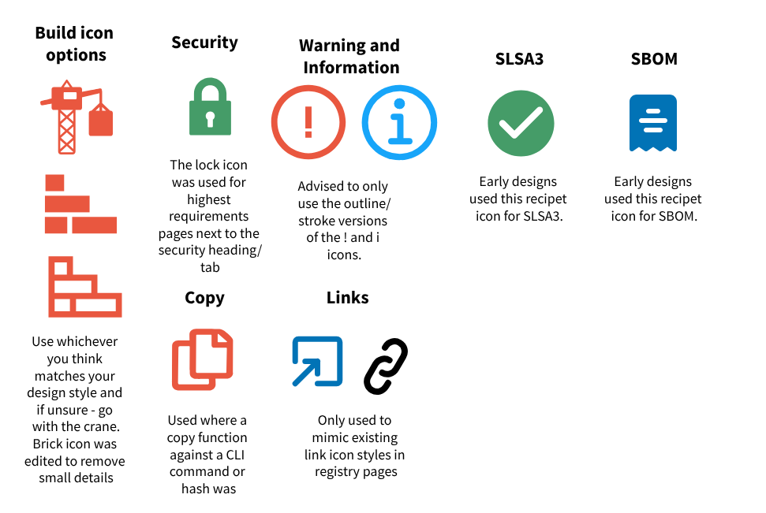
_アイコンの UI のスクリーンショット_

アイコンの画像に含まれている文章:

ビルドのアイコンについて: 自分たちのデザインのスタイルに合うと思うほうを使ってください。迷ったらクレーンにしてください。レンガのアイコンは、細かい部分を取り除くように編集しました
セキュリティのアイコンについて: 錠のアイコンは、最高水準の要件のページで、セキュリティの見出し／タブの隣に使いました
警告と情報のアイコンについて: ! と i のアイコンは、輪郭／線だけの版のみを使うことをおすすめします。
SLSA3 のアイコンについて: 初期のデザインでは、SLSA3 にこのレシートのアイコンを使っていました。
SBOM のアイコンについて: 初期のデザインでは、SBOM にこのレシートのアイコンを使っていました。
コピーのアイコンについて: CLI コマンドやハッシュに対するコピー機能があった箇所で使いました
リンクのアイコンについて: レジストリのページにある既存のリンクアイコンのスタイルをまねるためだけに使いました

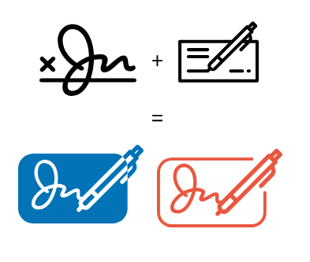
_署名アイコンの UI のスクリーンショット_

署名のアイコンは、作り上げるうえで決定的に重要なアイコンでした。署名、ペン、コンテナー、そして紙の書類で人が署名する「枠」や「線」の幅と高さの釣り合いを取るために、既存のアイコンを細かく編集する必要がありました。
このアイコンが、アテステーションや「署名」への言及がこの文脈で何を意味するのかをつかむ助けになったという点で、ユーザーは全員一致していました。つまり、アテステーションの文言で述べられていることに、何らかの主体が何らかの形で「署名して認めている」ということです。

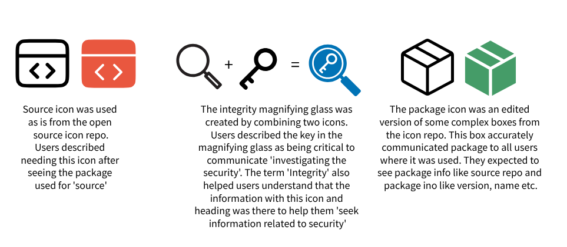
_アイコンの UI のスクリーンショット_

アイコンの画像に含まれている文章:

ソースのアイコンについて: ソースのアイコンは、オープンソースのアイコンリポジトリにあるものをそのまま使いました。ユーザーは、「source」にパッケージのアイコンが使われているのを見たあとで、このアイコンが必要だと述べました
完全性のアイコンについて: 完全性の虫眼鏡は、2 つのアイコンを組み合わせて作りました。ユーザーは、虫眼鏡のなかの鍵が「セキュリティを調べている」ことを伝えるうえで決定的に重要だと述べました。「Integrity」という語も、このアイコンと見出しが付いた情報は「セキュリティに関連する情報を探す」のを助けるためにある、とユーザーが理解する助けになりました
パッケージのアイコンについて: パッケージのアイコンは、アイコンリポジトリにあった複雑な箱を編集したものです。この箱は、使われたどの箇所でも、すべてのユーザーにパッケージであることを正確に伝えました。ユーザーは、ソースリポジトリのようなパッケージの情報や、バージョン、名前などのパッケージの情報がそこにあると期待していました。

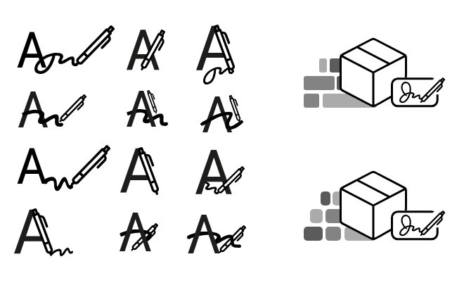
_アテステーション専用のアイコンの UI を検討した過程のスクリーンショット_

初期のころ、アテステーションの UI を 1 つのアイコンやバッジにまで切り詰めようとするデザインの作業を行いました。ある程度取り組んだ結果、セキュリティの専門家ではない大半のユーザーにとって、メッセージのないバッジやアイコンは役に立たないだろうと判断しました。バッジ／アイコンが役に立つユーザーペルソナは、すでにアテステーションをよく知っていて、作られたバッジ／アイコンにその知識を結び付けはじめる人たちだけです。これらの概念を 1 つのシンボルに切り詰める簡単な方法はありませんでした。グラフィックデザイン、アイコン、あるいはブランド／アイデンティティの表現の専門家とともに、何が作れるかをあらためて探る価値はあります。しかし現時点では、アテステーションのバッジ／アイコンについての進捗は下のとおりです。

私たちの初期のデザインのなかには、「出どころ」からパッケージへの署名済みのアテステーションの文言まで、アテステーションの「物語を語ろう」としたものがありました。郵便の小包が配達され、署名されるという視覚的なスタイルを作りました。この物語／インフォグラフィックの表現には可能性がありますが、レジストリのページの UI としては複雑すぎ、ユーザーは情報を集めるモードから物語を理解するモードへ切り替える必要がありました。インフォグラフィックは説明文書のページには向いているかもしれないので、テストするべきです。

* <https://www.svgrepo.com/svg/446714/magnifying-glass-2>
* <https://www.svgrepo.com/svg/437226/signature>
* <https://www.svgrepo.com/svg/212549/signature>
* <https://www.svgrepo.com/svg/509138/info>
* <https://www.svgrepo.com/svg/532318/key>
* <https://www.svgrepo.com/svg/521262/warning-circle>
* <https://www.svgrepo.com/svg/449387/lock>
* <https://www.svgrepo.com/svg/355633/bill-1-solid>
* <https://www.svgrepo.com/svg/325456/open-in-window>
* <https://www.svgrepo.com/svg/471214/code-browser>
* <https://www.svgrepo.com/svg/471736/package-check>
* <https://www.svgrepo.com/svg/525265/check-circle>
* <https://www.svgrepo.com/svg/510388/copy>
* <https://www.svgrepo.com/svg/523501/link>
* <https://www.svgrepo.com/svg/426115/crane>
* <https://www.svgrepo.com/svg/414268/build>

アイコンは、それぞれ異なる OSS ライセンスのもとで提供されています。帰属表示が必要なものもあります。<https://www.svgrepo.com/page/licensing/#CC%20Attribution> を参照してください。

## スタイルガイド: ハイパーリンク {#style-guide-hyperlinks}

ハイパーリンクに対するユーザーの行動と姿勢には微妙な違いがありました。とくに、ユーザーの好みと、コンポーネントのなかで使える限られたスペースとの釣り合いを取る場面でそうでした。

ハイパーリンクの使い方では、次の 2 点が決定的に重要だと分かりました。

1. スペースの制約で URL の全体を表示できない場合は、ホバーしたとき（マウスまたはタブ操作）に完全な URL が表示されるようにします。

2. 各リンクの説明の文言は、リンクの行き先や目的をはっきり示し、あいまいなラベルを避けるべきです（たとえば、`Learn more >` ではなく `See steps to complete process a checksum hash >` という文言を使います）

### 例: {#examples}
ハイパーリンクは、次のどの形でも使えます。ただし、そのスタイルは常にアクセシブルで、プラットフォーム全体のほかのハイパーリンクに使われている共通のスタイルと一貫しているべきです。

1. スペースに余裕がある場合の、ラベルと完全な URL:
`Transparency log: https://search.sigstore.dev/?logIndex=304840876`

2. ラベルと、省略記号で切り詰めた URL。ホバーすると全体が表示されます:
`Transparency log: https://search.sigstore.dev/?lo...`

3. ラベルと、短縮した URL:
`Transparency log: search.sigstore.dev/?logIndex=304840876`

4. ハイパーリンクのスタイルを付けた、説明的な語句:
`View transparency log >`

ハイパーリンクのスタイルも、プラットフォーム全体のほかのリンクと同じスタイルに従うべきです。

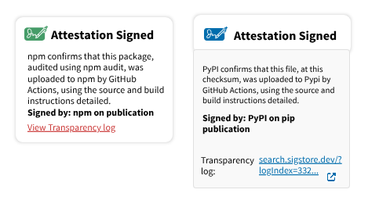
_ハイパーリンクの UI を検討した過程のスクリーンショット_

## スタイルガイド: 右から左へ書く言語についての注記 {#style-guide-a-note-on-right-to-left-languages}

デザインはすべて、左から右へ書く英語の文字を使うパッケージレジストリ向けに作りました。ドイツ語のように単語が長い言語や、アラビア語のように右から左へ読む言語を検討する余裕はありませんでした。

このプロジェクトや同様の内容についての作業が続く場合は、英語以外の言語への翻訳を行い、テストするべきです。加えて、デザインは、タブによる移動、スクリーンリーダーとの互換性、そして視線追跡装置のようなアクセシビリティのための道具についても評価するべきです。視線追跡装置では、選択のためにより大きな当たり判定の領域が必要になることがあります。

また、想定している西洋、米国／欧州、英語圏という文脈の外の文化で、意図しない意味を伝えてしまうアイコンがないことを確かめるために、アイコンの表現をテストすることもおすすめします。

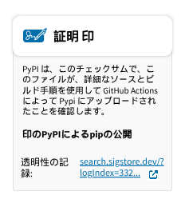
_右から左へ書く言語のスクリーンショット_

日本語は、「signature」つまり「サイン」が比較的新しい言葉であり、多くの日本人がいまも署名として「はんこ」（印鑑）を使っている、という例です。

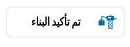
_右から左へ書く言語のスクリーンショット_

アラビア語では、すべての要素を右から左へ見られるようにする必要があります。

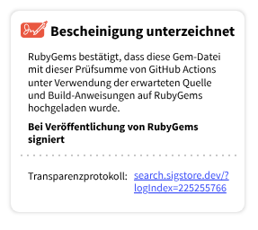
_右から左へ書く言語のスクリーンショット_

ドイツ語も役に立つ例です。英語では「Transparency log」のように 2 語になる言葉が、ドイツ語では「Transparenzprotokoll」のように 1 語になることがよくあるからです

## スタイルガイド: 説明文書についての推奨事項 {#style-guide-documentation-recommendations}

効果的な説明文書でユーザーを支えることは、アテステーションとは何か、どう使えるのかについて、ユーザーが理解を築くのを助ける鍵になります。

私たちの調査では、アテステーションについての既存の説明文書は、まったく存在しないか、専門家の読者だけに向けて書かれているかのどちらかでした。この問題に対処し、私たちの UI の推奨事項を支えるために、アテステーションの利用者に向けた効果的な説明文書をレジストリが作る助けとなるよう、次の原則を提案します。

アテステーションの説明文書の原則

1.  重要な用語を一貫して使う
2.  ユーザーの役割を軸に説明文書を構成する
3.  パッケージの利用者が、ほかのセキュリティ機能との関係のなかで
    アテステーションを理解できるような内容を用意する
4.  パッケージは既定で安全なわけではないことを、パッケージの利用者に注意喚起する
5.  既定で安全な公開ワークフローを当たり前のものにする
6.  よくある攻撃と、それがどのように緩和されるのかを説明する
7.  限界について率直に示し、何を期待できるのかをはっきりさせる

それぞれの原則について詳しくは、[Best practices for documenting attestations in Package Repositories](https://repos.openssf.org/attestations-style-guide/pdfs/best_practices_for_documenting_attestations_in_package_repositories.pdf)（パッケージリポジトリでアテステーションを文書化するためのベストプラクティス）を参照してください。

## スタイルガイド: 説明文書の原則を RubyGems.org、PyPI、npm に当てはめる {#style-guide-applying-documentation-principles-to-rubygemsorg-pypi-and-npm}

RubyGems.org、PyPI、npm がアテステーションの説明文書のベストプラクティスを取り入れる助けとなるよう、私たちはそれぞれのリポジトリに向けた具体的な推奨事項を作りました。それぞれの推奨事項には、ユーザーテストを経たテンプレートが含まれており、新しい説明文書を作るときにも、既存の資料を改訂するときにも使えます。

RubyGems.org、PyPI、npm には、これらのテンプレートを、適切だと思う形で使い、改良し、拡張していただければと思います。ほかのパッケージリポジトリも、自分たちのアテステーションの説明文書を作るときの参考として、これらのテンプレートを使えます。

* [RubyGems.org 向けの説明文書の推奨事項](https://repos.openssf.org/attestations-style-guide/zips/rubygems_attestation_documentation_templates.zip)
* [PyPI 向けの説明文書の推奨事項](https://repos.openssf.org/attestations-style-guide/zips/pypi_attestation_documentation_templates.zip)
* [npm 向けの説明文書の推奨事項](https://repos.openssf.org/attestations-style-guide/zips/npm_attestation_documentation_templates.zip)

---

次: [説明文書についての推奨事項](documentation.html)

