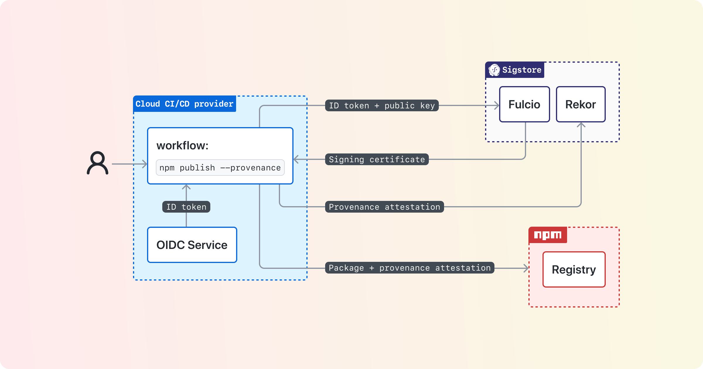
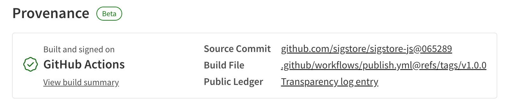


# すべてのパッケージレジストリにビルド来歴を {#build-provenance-for-all-package-registries}

最終更新: 2023 年 7 月

レジストリが提供できる新しいセキュリティ機能があります。ビルド来歴（build provenance、ビルドプロベナンス）です。これは、パッケージを、そのソースコードとビルド手順まで検証可能な形で結び付けるものです。この結び付きは公開されているので、パッケージの利用者は、ビルドの過程やソースコードが侵害されていないと信じるしかなかったところを、パッケージの中身がうたわれているとおりであることを自分で検証できます。

## なぜビルド来歴なのか {#why-build-provenance}

**目的は、パッケージがその中身について透明であるようにすることです。** 現在、多くのパッケージングシステムでは、メンテナーがソースコードへのリンクを手作業で指定できます。しかし、そこに書かれた情報が、そのパッケージを作るのに実際に使われたものだという保証はありません。ビルド来歴は、こうしたリンクが存在すること、そして偽造できないことの両方を保証します。ただし、ビルド来歴のあるパッケージが _本質的に_ 安全である、あるいは信頼できるという意味ではないことに注意してください。あくまで、そうしたリンクが確かに存在するというだけです。パッケージの利用者は、やはりそのリンクをたどり、手作業での確認やそのほかのポリシーによって、信頼できるかどうかを自分で判断する必要があります。

## ビルド来歴の仕組み {#how-build-provenance-works}

ビルド来歴は、クラウドの CI/CD プロバイダー、[Sigstore](https://www.sigstore.dev/how-it-works) と呼ばれる公共財としての署名サービス、そしてパッケージレジストリ（npm など）が協力して作り出します。

大まかに言うと、クラウドの CI/CD システムが、パッケージのビルドに、決められたソースコードとビルド手順が使われることを強制し、その情報を署名付きの OIDC トークンで提供します。次に、それらのビルドの属性が Sigstore に送られます。Sigstore は、個々のパッケージが鍵を管理しなくても署名できるようにするとともに、監査のための公開の透明性ログを提供します。Sigstore によって署名されたビルド来歴は、パッケージのアップロード時にレジストリに送られ、ユーザーがパッケージを利用するときに提供されます。

## 設計上の判断 {#resulting-design-decisions}

実装をさらに詳しく見ていく前に、パッケージがその中身について透明であるという目的から導かれる、いくつかの設計上の判断について説明します。

来歴が強いセキュリティ上の保証をもたらすには、次のことができるビルドシステムを使う必要があります。

- 隔離された、使い捨ての環境でビルドを実行する
- ビルドの属性を、ビルド手順そのものからは改ざんできない方法で、レジストリに安全に伝える

これらの要件があるので、信頼できるビルド来歴はどこででも生成できるわけではありません。たとえば個人の開発用マシンでは生成できません。それでかまいません！ パッケージレジストリの中には、誰もが新しいコンテンツをすばやく公開できることを使命としているものがあるので、**レジストリがすべてのパッケージにビルド来歴を _必須_ にすることは推奨しません**。代わりに、メンテナーには、ビルド来歴をオープンソースプロジェクトの成熟に向けた重要な一歩と考えることを勧めます。プロジェクトが成長するにつれて、正式なコントリビューションのルールを設ける、メンテナーの責任を明文化する、セキュリティ脆弱性の報告ポリシーを整えるといった、成熟に向けたほかの取り組みとあわせて、ビルド来歴をプロジェクトに追加するとよいでしょう。

その代わりに、**ビルドはクラウドの CI/CD システム上で行う**ことを推奨します。クラウドの CI/CD システムは、隔離、使い捨てのランナー、そしてビルドからは改ざんできない署名付きのビルドメタデータを提供できます。これらのクラウドの CI/CD システムからの情報は、Sigstore の Fulcio コンポーネントに送られます。Fulcio がどのクラウドの CI/CD システムを信頼しているかは <https://github.com/sigstore/fulcio/tree/main/federation> で確認できます。また、それらのクラウドの CI/CD システムが提供しなければならない情報は <https://github.com/sigstore/fulcio/blob/main/docs/oid-info.md#requirements-to-support-signing-with-cicd-workload-identities> で確認できます。

なお、**ビルド来歴は、パッケージを、確認済みの人間の身元に結び付けようとするものではありません**。代わりに、ビルドシステムのワークロードアイデンティティに焦点を当てています。パッケージを作り出すのはそれだからです。人間を強く認証し、その意図を見極めようとすることは複雑な問題領域であり、ビルド来歴の対象外です！

2023 年 4 月時点で、[npm でビルド来歴のパブリックベータ](https://github.blog/2023-04-19-introducing-npm-package-provenance/)が提供されています。ここでは npm がこの機能をどのように実装したかを取り上げ、それを軸に、ほかのレジストリに来歴を追加する方法を説明します。

# npm のビルド来歴 {#npm-build-provenance}

ビルド来歴の仕組みを大まかに示した図を、もう一度載せます。

これを、いくつかの部分に分けて見ていきましょう。

- クラウドの CI/CD システムから情報を集める
- レジストリを拡張してビルド来歴に対応させる
- 検証のためにビルド来歴をユーザーに提供する

# クラウドの CI/CD プロバイダーから情報を集める {#collecting-information-from-the-cloud-cicd-provider}

ビルドの過程から呼び出せる、再利用可能な仕組みが必要です。この仕組みは、CI/CD プロバイダーから情報を取得し、それを標準の形式に組み立て、その情報を Sigstore とレジストリに送ります。

この機能は CLI ツールに組み込むことを推奨します。ほとんどのエコシステムでは、パッケージの公開の過程にすでに何らかの CLI ツールが関わっています。CLI ツールに組み込めば、実装を複数の CI/CD プロバイダーで共有できます。

来歴の組み立てと Sigstore のサービスとのやり取りについての詳しい技術仕様は、[Sigstore Client Specification](https://docs.google.com/document/d/1kbhK2qyPPk8SLavHzYSDM8-Ueul9_oxIMVFuWMWKz0E/edit?usp=sharing) を参照してください。ここでは、ツールがたどる手順の概要を説明します（リファレンス実装としては、[npm CLI の publish.js](https://github.com/npm/cli/blob/latest/workspaces/libnpmpublish/lib/publish.js) を見てください）。

レジストリが非公開パッケージに対応している場合、レジストリは、扱っているのが公開パッケージであることを確認するべきです。ビルドのメタデータは Sigstore の透明性ログである Rekor に公開されますが、非公開パッケージの公開者は、それを公にしたくないかもしれないからです。

次に、Sigstore の Fulcio が受け付ける OIDC トークンを要求します。レジストリは、[Fulcio が対応している CI/CD プロバイダー](https://github.com/sigstore/fulcio/tree/main/federation)の上で動いていることを確かめるべきです。そうであれば、オーディエンスを "sigstore" に設定した OIDC トークンを要求します。

続いて、ビルド来歴の証明（アテステーション）を組み立てます。証明の文書の形式には [in-toto attestations](https://github.com/in-toto/attestation/blob/main/spec/README.md#in-toto-attestation-framework-spec) を、in-toto の証明文書の中の述語（predicate）には [SLSA provenance](https://slsa.dev/provenance/v1) を使うことを推奨します。リファレンス実装としては、[npm CLI の provenance.js](https://github.com/npm/cli/blob/latest/workspaces/libnpmpublish/lib/provenance.js) を参照してください。また、[SLSA provenance 用の公式の in-toto プロトコルバッファ](https://github.com/in-toto/attestation/blob/main/protos/in_toto_attestation/predicates/provenance/v1/provenance.proto)があることも覚えておいてください。

これでパッケージに署名する準備ができました！ 使い捨ての鍵ペアを作り、次のものを Fulcio に送ります。OIDC トークン、使い捨ての公開鍵、秘密鍵で署名した OIDC のサブジェクト（「チャレンジ値」）、そして秘密鍵で署名したビルド成果物の署名です。リファレンス実装としては、[sigstore-js の sign.ts](https://github.com/sigstore/sigstore-js/blob/main/packages/client/src/sign.ts#L110) を参照してください。

Fulcio は X.509 の署名用証明書を返します。この証明書には、ビルド来歴の属性（あなたの公開鍵を含む）が OID として含まれています。この時点で、使い捨ての秘密鍵は捨ててかまいません。

しかし、まだレジストリに送る準備は整っていません。まず、ビルドの証明文書に（Fulcio の署名用証明書で）署名し、それを Sigstore の Rekor に公開して、透明性ログのエントリを取得します。そのうえで、ビルド成果物に対する署名、ビルドの証明文書、透明性ログのエントリ、そしてタイムスタンプをまとめた、Sigstore の署名バンドルを作ります。この署名バンドルを、パッケージを公開するときにレジストリに送ります。

この Sigstore とのやり取りを、どこまで自分で実装する必要があるのか、気になるかもしれません。理想的には、エコシステムのツールが対応している言語で書かれた、成熟した Sigstore ライブラリがあるとよいでしょう。現在、[JavaScript](https://github.com/sigstore/sigstore-js)、[Go](https://github.com/sigstore/sigstore-go)、[Python](https://github.com/sigstore/sigstore-python) のライブラリがあり、[Rust](https://github.com/sigstore/sigstore-rs)、[Ruby](https://github.com/sigstore/ruby-sigstore)、[Java](https://github.com/sigstore/sigstore-java) のライブラリも開発中です。クライアントライブラリが期待どおりに動作することを確かめるには、[sigstore-conformance](https://github.com/sigstore/sigstore-conformance) を参照してください。

# レジストリを拡張してビルド来歴に対応させる {#extending-the-registry-to-support-build-provenance}

これで、パッケージをレジストリに公開する準備ができました。従来、公開リクエストは、API キーやパスワードのような、長期間有効な共有シークレットを使って認可されてきました。しかし、クラウドの CI/CD システムは、ワークロードアイデンティティを含む OIDC トークンを持つようになりました。そのため、OIDC トークンに含まれる属性に基づく信頼関係によって、公開リクエストを認可できます。その例としては、<https://docs.pypi.org/trusted-publishers/> を参照してください。実のところ、レジストリは、Sigstore のクライアントライブラリによる支援がまったく無くても、公開リクエストを認可するための OIDC の信頼関係を実装できます。ですから、これは最初に取り組むのにちょうどよい、範囲の絞られたプロジェクトです。PyPI が行ったのは、まさにこれでした。

パッケージと署名付きのビルドの証明がそろったので、ここからはレジストリに目を移し、レジストリが公開リクエストを処理する際に、その情報をどのように検証するかを見ていきます。どのプログラミング言語でどの Sigstore ライブラリが使えるかについては、上の説明を参照してください。

Sigstore のバンドルを検証する方法の詳しい説明は、[Sigstore Client Specification の Verification の節](https://docs.google.com/document/d/1kbhK2qyPPk8SLavHzYSDM8-Ueul9_oxIMVFuWMWKz0E/edit#heading=h.g11ovq2s1jxh)を参照してください。これに加えて、レジストリは、そのバンドルが自らの対応しているクラウドの CI/CD ベンダーから来ていること、そして（当然ながら）パッケージのハッシュが Sigstore のバンドルに記録されているものと一致することも検証する必要があります。

レジストリに行うことを推奨する検証が、最後にもう 1 つあります。前のバージョンに来歴があったかどうかを確認し、あった場合は、ソースコードの URI が新しくなっていないか（つまり、プロジェクトが新しい名前、新しい組織、または新しいソースコードのプロバイダーに移っていないか）を確認することです。これは侵害の兆候である可能性もありますが、プロジェクトの通常の変化である可能性もあります。レジストリは、予期しない来歴の変更を許可しないことを推奨します。ただし、パッケージの来歴が変わる見込みであることを、パッケージのメンテナーが事前に示せる手段を提供するべきです。これに関連して、来歴付きで公開したことのあるパッケージが、その後に来歴無しで公開することを、レジストリは許可しないことを推奨します。ただし、今後は来歴付きで公開しないつもりであることをメンテナーが事前に示している場合は別です。

加えて、レジストリが [`publish`](https://github.com/npm/attestation/tree/34f164c30ea75a364646e2439d9d1408bea57585/specs/publish/v0.1) の証明文書を作り、Sigstore の Rekor に送ることを推奨します。これにより、どのパッケージが来歴付きでレジストリに公開されたかについて、監査可能な公開の記録ができます。公開された証明の例は、<https://search.sigstore.dev/?logIndex=20766332> を参照してください。なお、これは OIDC トークンや Fulcio の署名用証明書を使って認証されるものでは\*ありません\*。publish の証明への署名には、レジストリが管理する、HSM で保護された永続的な署名鍵を使うことを推奨します。

バンドルが検証され、publish の証明が公開の場に記録されたら、後で使うために、パッケージと Sigstore のバンドルを保存できます。レジストリは、特定のバージョンのパッケージと、それに対応する来歴との間で、一対一の対応を保つべきです。また、対応するパッケージのバージョンを保持している限り、その来歴も保持するべきです。

# 検証のためにビルド来歴をユーザーに提供する {#supplying-build-provenance-to-users-for-verification}

ビルド来歴を生成することは、重要な最初の一歩です。しかし、セキュリティ機能としての価値が生まれるのは、この情報をユーザーに提供し、ユーザーがそれを検証し、その情報を使って、十分な情報に基づいたリスクの判断を下せるようになったときです。

ビルド来歴を提供するにあたって、レジストリは、リンクされているソースコードとビルド手順が今も存在することを、定期的に確かめるべきです。存在しなくなっている場合、レジストリは、そのパッケージにはもう来歴が無いものとして扱うべきです。

ビルド来歴は、3 つの方法で提供することを推奨します。レジストリの Web UI、レジストリへの API 呼び出し、そして CLI ツールです。

レジストリの Web UI は、パッケージに来歴があることを利用者に伝えるべきですが、それによって自動的に信頼できるということを伝えるべきでは**ありません**。思い出してください。ビルド来歴は、ソースコードとビルド手順へさかのぼるリンクを提供するだけです。パッケージの利用者は、やはりそのリンクをたどって、信頼できるかどうかを評価する必要があります。ソースコード、ビルド手順、そしてビルド来歴の透明性ログのエントリへさかのぼる、文字どおりのリンクを提供することを推奨します。npm レジストリでは、次のように表示されます。

レジストリは、この情報をプログラムから取得できる形でも提供するべきです。パッケージ名とバージョンを指定すると、対応する Sigstore のバンドルを返す API エンドポイントを、レジストリに追加することを推奨します。

最後になりましたが、これも同じく重要です。CLI ツールで、特定のパッケージの来歴を取得して検証する方法を提供することを推奨します。CLI は、上で説明したレジストリの API エンドポイントからビルド来歴を取得し、これも上で説明した、レジストリがバンドルを受け取ったときと同じ手順に従って、バンドルを検証するべきです。あなたの言語のエコシステムでどの Sigstore ライブラリを使うかを決めるには、（お察しのとおり）上の説明を参照してください。

# まとめ {#summary}

レジストリにビルド来歴を追加するのは、小さな仕事ではありません。しかし、パッケージが、何を含んでいて、どのようにビルドされたかについて透明になれるという点で、大きなセキュリティ機能が加わります。

どこから始めればよいかわからない場合は、Sigstore をいったんすべて飛ばして、<https://docs.pypi.org/trusted-publishers/> のように、クラウドの CI/CD システムの OIDC トークンによる公開の認可を可能にすることに集中するとよいでしょう。そうすれば、パスワードや API キーをビルドシステムに保存する必要がなくなるので、レジストリのセキュリティが高まります。また、ユーザーに OIDC トークンという考え方に触れてもらうこともできます。

Sigstore を使ったビルド来歴の提供を、あなたのエコシステムに提案する準備ができたら、強調するとよい点がいくつかあります。

- 目的は、パッケージがその中身について透明であるようにすることである
- レジストリがすべてのパッケージにビルド来歴を必須にすることは推奨しない
- ビルドはクラウドの CI/CD システム上で行う
- ビルド来歴は、パッケージを、確認済みの人間の身元に結び付けようとするものではない

作業の計画を立てる段階では、Sigstore のバンドルを生成し検証するためのライブラリが必要になります。可能な限り、バインディングのある、既存の成熟したライブラリを使うことを推奨します。そのうえで、作業を次のように分けられます。CLI がビルド中に情報を集める部分、レジストリが情報を検証・保存・提供する部分、そして CLI がパッケージの利用時に情報を取得して検証する部分です。

