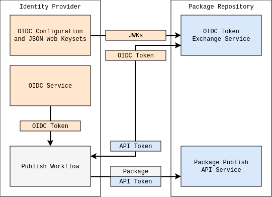


# すべてのパッケージリポジトリに Trusted Publishers を {#trusted-publishers-for-all-package-repositories}

著者: [Seth Michael Larson (Python Software Foundation)](https://github.com/sethmlarson)

最終更新: 2025 年 5 月

Trusted Publishers は、既存の標準である OpenID Connect（OIDC）の上に作られた新しい認証方式です。ユーザーが管理するインフラから公開のパッケージリポジトリへ公開する場面（たとえば CI から PyPI への公開。メンテナーが自分のマシンから公開する場合や、Homebrew のような集中型のビルドとは異なります）で使います。認証は、OIDC の ID トークンを、パッケージリポジトリの公開用 API に対して認証するための、短命で権限の範囲を狭く絞った API トークンと交換することで行います。短命な API トークンを使えば、ソフトウェアを公開するときに、長期間有効で、場合によっては強い権限を持つ API トークンを外部のシステムと共有する必要がなくなります。

## なぜ Trusted Publishers なのか {#why-trusted-publishers}

**Trusted Publishers の目的は、パッケージリポジトリに対して認証するときに、長期間有効なトークンや認証情報を外部のシステムと共有する必要を減らすことです。** 長期間有効なトークンのライフサイクルを管理することは、パッケージインデックスとメンテナーに、[セキュリティと管理の面で余分な課題をもたらします](https://www.bleepingcomputer.com/news/security/over-12-million-auth-secrets-and-keys-leaked-on-github-in-2023/)。

Trusted Publishers は、一度設定すれば、ユーザーによる保守がほとんど、あるいはまったく要りません。ユーザーは長期間有効なシークレットを手作業で管理しなくてよくなるので、使いやすく安全な公開体験が得られます。また、Trusted Publishers を使うと、メンテナーは認可をマシン／ワークロードのアイデンティティに集約できます。パッケージリポジトリ側でユーザーと認証を別途管理する必要はありません。

Trusted Publishers は、使えるようになるとユーザーによく使われます。たとえば PyPI は 2023 年 4 月に Trusted Publishers への対応を追加し、それ以来、[13,000 を超えるプロジェクト](https://p.datadoghq.com/sb/7dc8b3250-b3f27ea9680eb560a2a1fb8ee12ff00b?fromUser=false&refresh_mode=sliding&from_ts=1716921809407&to_ts=1719513809407&live=true)が自発的に Trusted Publishers を採用しています。

Trusted Publishers は、パッケージが特定の CI システム、ワークフロー、ホストされたマシン、またはビルドパイプラインから来ていることを保証します。長期間有効な API トークンとは違い、持ち出されて悪用されうる期間を短くできます。

Trusted Publishing のプロバイダーによっては、Trusted Publishers を使って、ソースリポジトリの URL のような検証可能なメタデータを、公開された成果物に結び付けることができます。これによりパッケージリポジトリは、「[スタージャッキング（Star-Jacking）](https://capec.mitre.org/data/definitions/693.html)」や、プロジェクトの信頼性についてユーザーを惑わせる同種の攻撃を避けられます。

Trusted Publishers は、PyPI や RubyGems のように、ユーザーがビルドしたパッケージを受け付けるパッケージリポジトリに最適です。Homebrew のように集中型のビルド基盤を持つパッケージリポジトリは、これには当たりません。

Trusted Publishers は、SLSA のビルド来歴（build provenance）のようなほかの技術とも相性がよいものです。同じ基盤技術である OIDC 標準の上に作られているからです。

独立した成果物をホストしないパッケージリポジトリ（pkg.go.dev など）では、リポジトリに対する認証が要らないので、Trusted Publishers は当てはまりません。

## Trusted Publishers の仕組み {#how-trusted-publishers-works}

Trusted Publishers を使うと、Python Package Index（PyPI）のようなパッケージリポジトリが、GitHub Actions や GitLab Pipelines のようなアイデンティティプロバイダー（Identity Provider、IdP）が発行するアイデンティティを、OpenID Connect（OIDC）と呼ばれる技術を使って認証できます。

Trusted Publishers では、公開を受け付ける側のパッケージリポジトリに、ユーザーがあらかじめ信頼ポリシー（trust policy）を設定しておく必要があります。このポリシーは、後で公開リクエストを認証するときに使われます。新しい成果物がレジストリに公開されるとき、OIDC の ID トークン（JWT として実装されています）は、[JWT のクレームと署名を IdP の JSON Web Keyset（JWK）と照らし合わせて](https://www.criipto.com/blog/jwt-validation-guide)検証されます。さらに、OIDC の ID トークンの発行者とクレームが、[そのパッケージにあらかじめ設定された信頼ポリシー](https://docs.pypi.org/trusted-publishers/adding-a-publisher/#github-actions)と一致することが確認されます。

信頼ポリシーは、必ずしもパッケージに _直接_ 結び付いている必要はありません。たとえば、パッケージリポジトリによっては、信頼ポリシーをパッケージの名前空間に割り当てたい場合もあるでしょう。信頼ポリシーは、あるワークロードのアイデンティティが、あるパッケージを公開できるかどうかを決めるものです。

JWK は、[OpenID Connect Discovery の well-known URL](https://swagger.io/docs/specification/authentication/openid-connect-discovery/) を使って見つけます。この URL は、JWT の発行者（“iss”）クレームに基づいて決まります。たとえば、GitHub の “iss” クレームは “[https://token.actions.githubusercontent.com](https://token.actions.githubusercontent.com)” なので、OpenID Connect Discovery の well-known URL は “[https://token.actions.githubusercontent.com/.well-known/openid-configuration](https://token.actions.githubusercontent.com/.well-known/openid-configuration)” になります。

PyPI が、あらかじめ設定されたポリシーに照らして OIDC の ID トークンを検証する流れの概要は、次のとおりです。

* クレームも署名も検証せずに JWT を解析し、発行者クレーム（`iss`）を取り出します。ここで解析した JWT は必ず破棄し、この段階でサービスがその JWT を検証済みとして扱わないようにしてください。
* この発行者を、パッケージリポジトリが対応している OIDC アイデンティティプロバイダーの一覧と照らし合わせ、トークンを検証するための実装（たとえば “GitHub” や “GitLab”）を選びます。
* 発行者の OpenID Connect Discovery の URL と JWK を取得します。
* JWK を使って、[JWT の署名とクレームを検証します](https://www.criipto.com/blog/jwt-validation-guide)（`nbf`、`exp`、`jti` などのクレーム）。
* オーディエンスクレーム（`aud`）が、サービスに固有の値（つまり `pypi` や `testpypi`）と等しいことを検証します。このためには、発行する OIDC の ID トークンのオーディエンスを設定できる機能に、IdP が対応している必要があります。
* クレームを使って、その Trusted Publisher にあらかじめ設定された信頼ポリシーと値を照合します。たとえば GitHub のワークフローであれば、次のクレームを確認します。
    * `sub`（Subject）が `example-owner/example-repo:.*` の形式である
    * `repository` が `example-repo` である
    * `repository_owner` が `example-owner` である
    * `repository_owner_id` が `12345` である
    * `workflow_ref` が `example-owner/example-repo/.github/workflows/publish.yml@abcdef` である

ここまで完了すると、パッケージリポジトリは、リポジトリが管理するトークンに委ねる形で、公開を認可できます。

この文書では、OIDC の ID トークンを、リポジトリが管理する別のトークンと交換することを推奨しています。ただし、この手順は必須ではなく、OIDC の ID トークンをそのまま公開リクエストの認証に使ってもかまいません。この推奨の理由について詳しくは、「設計上の判断」の節を参照してください。

パッケージリポジトリが対応したい IdP ごとに、それぞれ専用の実装が必要になります。OIDC の ID トークンに含まれるクレームは、（JWT トークンの標準的な発行者、有効期限、オーディエンスのクレームを除けば）プロバイダーによって異なるからです。確認の対象として選ぶクレームの組は、パッケージの信頼ポリシーと照合するのに十分信頼できるメタデータになっていなければなりません。Trusted Publisher の実装は、汎用的なクレームの組だけ（つまり `sub` + `iss` + `aud` だけ）に頼ってはなりません。多くの IdP では、これだけでは十分に信頼できる組にならないからです。

## 設計上の判断 {#resulting-design-decisions}

### Trusted Publishers のセキュリティモデル {#security-model-of-trusted-publishers}

Trusted Publishers は、長期間有効な API トークンよりも安全な認証モデルです。しかし、万能薬ではありません。安全な構成を保つために、ユーザーは次のセキュリティモデルに従わなければなりません。

* OIDC の ID トークンや、リポジトリが管理する API トークンのような短命なトークンも、やはり機密性の高い情報であり、漏らすべきではありません。これらのトークンのどちらかが漏れると、有効期限が切れるまでの間、攻撃者がそれを使って悪意のあるパッケージをリポジトリに公開できてしまいます。
* Trusted Publisher を設定するということは、何らかの外部の状態に対して信頼を確立するということです。その外部の状態（IdP そのものと、IdP が管理するリソースの両方）は、信頼できない者が制御できるものであってはなりません。

このセキュリティモデルは、そのパッケージリポジトリで Trusted Publishers を導入する方法を説明したプロバイダー別のガイドとあわせて、文書化しておくことを推奨します。

### Trusted Publishers のデータモデル {#data-model-of-trusted-publishers}

Trusted Publisher の設定とパッケージとのデータモデルとして直感的に思いつくのは、1 つのパッケージに成果物の出どころが 1 つという、一対一の関係です。しかし、多くのパッケージングエコシステムでは、成果物の出どころをプロジェクトに対して認証するという既存の使い方をすべて支えるために、多対多の方式が必要になります。

「モノレポ」とは、複数の別々のプロジェクトのソースコードが、1 つのソースリポジトリに保存されている形のことです。モノレポは多くのパッケージングエコシステムでよく見られます。モノレポが存在するため、Trusted Publisher の設定と、パッケージリポジトリ上のパッケージとの間には、一対多の関係が必要です。

1 つのリリースに複数の成果物があったり、複数のプラットフォームや CPU アーキテクチャに対応するために複数の公開ワークフローがあったりするパッケージングエコシステム（Python など）では、逆向きの「一対多」の関係が必要です。つまり、複数のビルドシステムから公開できるように、1 つのパッケージに対して複数の Trusted Publisher の設定を持てるようにします。

### アイデンティティプロバイダーとクレーム {#identity-providers-and-claims}

OIDC の ID トークンは [JSON Web Token](https://en.wikipedia.org/wiki/JSON_Web_Token)（JWT）として実装されており、一組のクレームを伴います。クレームには、標準の OIDC クレームと、プロバイダー固有のクレームが混在しています。

IdP は、オーディエンスクレーム（`aud`）のカスタマイズに対応していなければなりません。また、Trusted Publisher の実装は、サービスに固有のオーディエンスクレーム（たとえば “pypi”）を持つ OIDC の ID トークンだけを受け付けなければなりません。

IdP はそれぞれ、OIDC の ID トークンに独自のクレームの組を持っています。あるプロバイダー向けの Trusted Publisher を作るには、どの部分集合がユーザーに提供するのに十分信頼できる組になるかを判断するために、そのプロバイダーの内部の実装と挙動についての知識が必要です。Trusted Publisher の実装は、汎用的なクレームの組だけ（つまり `sub` + `iss` + `aud` だけ）に頼ってはなりません。多くの IdP では、これだけでは十分に信頼できる組にならないからです。

IdP は、OIDC の ID トークンが使われる状況に応じて、クレームの組を変えます。たとえば GitHub には、再利用可能なワークフローや、ワークフローのトリガーの種類ごとに特別なクレームがあります。また、プロバイダーがクレームを変更することがあり、その際の事前の予告や、変更についての文書の程度はまちまちであることも知られています。

一部の IdP は `jti` クレームに対応しています。IdP が対応している場合、Trusted Publisher の実装は `jti` クレームを活用し、過去に使われたトークンを拒否することで、OIDC の ID トークンのリプレイを防ぐべきです。

IdP によっては、OIDC の ID トークンの有効期間のような、ほかのクレームもカスタマイズできることがあります。Trusted Publisher の実装は、IdP 側で可能な場合に OIDC の ID トークンをより安全に扱わせるため、IdP とその OIDC の ID トークンに対して、さらなる要件（有効期間の上限など）を加えることにしてもかまいません。

### OIDC の ID トークンと、リポジトリが制御するトークン {#oidc-id-tokens-and-repository-controlled-tokens}

パッケージリポジトリは、パッケージ公開用の API に対する認証に、OIDC の ID トークンを直接使うべきではありません。代わりに、OIDC の ID トークンを、リポジトリが制御する API トークンと交換し、その API トークンを公開用 API に対する認証に使うべきです。交換する理由を以下に挙げます。

* パッケージリポジトリがすでにトークンによる認証に対応している場合、OIDC の ID トークンは、既存の認証と認可の実装にそのままでは組み込めません。そのため、OIDC の ID トークン用に実装し直すことになります。結果として 2 種類のトークンを抱えることになり、バグが増えるおそれがあります。
* JWT には、プロバイダーが含めると決めた情報なら何でも入りえます。たとえば、非公開の情報や、個人を特定できる情報（つまり名前やメールアドレス）です。別のトークンを使えば、こうした情報を長期間保持せずに済み、露出や残留のおそれを減らせます。
* アイデンティティプロバイダーは、トークンの有効期限やそのほかのポリシーを、予告なく変更できます。自前の一時トークンを作ることで、リポジトリはこうした変更の影響を受けにくくなります。
* リポジトリが管理するトークンのほうが、パッケージを公開するための既存のツールに組み込みやすくなります。
* リポジトリが管理するトークンは、シークレットスキャンのような外部の基盤の恩恵を受けられます。

API トークンによる認証に対応していないパッケージリポジトリには、Trusted Publisher の実装の一部として、この機能を実装することを推奨します。

### 復活攻撃と改名攻撃 {#resurrection-and-rename-attacks}

多くのサードパーティのリソースには、人間が読めて見つけやすい属性（変更可能な GitHub のオーナー名やリポジトリ名など）があります。こうした属性は、人間には扱いにくいものの、そのリソースについてはるかに強い保証になる属性（変更不可能な GitHub のオーナー ID など）と対応しています。

リソースの名前は、たいてい変更可能です。そのため、信頼ポリシーが名前だけに依存していると、対応する Trusted Publisher を更新しないままサードパーティのサービス上でリソースが改名されたり削除されたりした場合に、そのポリシーが悪用されるおそれがあります。

Trusted Publisher のポリシーは、たいてい人間が設定します。そのため、ID よりもリソースの名前を入力するほうが使いやすくなります。この問題を緩和するために、多くのサービスでは、Trusted Publisher を設定する処理の一部として、サードパーティのサービスに問い合わせて、設定された名前から ID を「解決」し、その ID を Trusted Publisher のポリシーの一部として保存します。

この方法には限界があります。すべてのリソースに ID があるわけではないからです（たとえば、GitHub の「ワークフローのファイル名」には ID がありません）。それでも、問題をできるだけ狭く絞り込んでおけば、よくある問題の大半は防げるはずです。

### 「保留中（Pending）」の Trusted Publishers {#pending-trusted-publishers}

ここまで説明してきた Trusted Publishers は、パッケージそのものやパッケージの名前空間など、パッケージリポジトリに _すでに存在する_ リソースに結び付けられます。しかしこれは、成果物が最初にアップロードされたときにしか _新しいパッケージを作れない_ パッケージリポジトリ（たとえば PyPI がそうです）に、因果関係のジレンマ（どちらが先かという問題）を残します。この性質を持つパッケージリポジトリでは、Trusted Publisher を使って新しいパッケージを作ることができません。Trusted Publisher を設定するには、その前にパッケージが存在していなければならないからです。この状況をそのままにしておくと、ユーザーは Trusted Publishers を採用する前に、より安全でない別の公開方法を使わなければなりません。これは使いやすさの問題でもあり、セキュリティの問題でもあります。

この問題の解決策の 1 つが、[「保留中（Pending）」の Trusted Publishers](https://docs.pypi.org/trusted-publishers/creating-a-project-through-oidc/) を実装することです。これは、初めて使われるまでは特定のアカウントまたは組織にだけ結び付けられ、初めて使われた時点で、特定のパッケージまたはパッケージの名前空間にさらに結び付けられます。アップロードの認証に初めて使われるとき、「保留中」のモデルは通常の Trusted Publisher に変換され、データベース内で、認証されたリソースに関連付けられます。この処理は、アップロードの途中で一部だけが成功する事態を避けるために、モデルを保存するのと同じデータベーストランザクションの中で行われます。

## 対応状況 {#support}

2025 年 12 月時点で、次のパッケージリポジトリが Trusted Publishers に対応しています。

- [Dart の pub.dev](https://dart.dev/tools/pub/automated-publishing)
- [npm](https://docs.npmjs.com/trusted-publishers)
- [NuGet](https://learn.microsoft.com/en-us/nuget/nuget-org/trusted-publishing)
- [Python Package Index](https://blog.pypi.org/posts/2023-04-20-introducing-trusted-publishers/)
- [RubyGems.org](https://blog.rubygems.org/2023/12/14/trusted-publishing.html)
- [Rust のクレート](https://crates.io/docs/trusted-publishing)

## 参考資料 {#references}

* [https://docs.pypi.org/trusted-publishers/internals/](https://docs.pypi.org/trusted-publishers/internals/)
* [https://docs.pypi.org/trusted-publishers/security-model/](https://docs.pypi.org/trusted-publishers/security-model/)
* [https://docs.google.com/presentation/d/e/2PACX-1vTJ2k4yr4tzug5Nf4HIrJ9Am2vMX2I1b0wUlreDPZc2dbWow9SRm78fmuvlyhEggtdk1Mefme3nmtd_/pub](https://docs.google.com/presentation/d/e/2PACX-1vTJ2k4yr4tzug5Nf4HIrJ9Am2vMX2I1b0wUlreDPZc2dbWow9SRm78fmuvlyhEggtdk1Mefme3nmtd_/pub)

